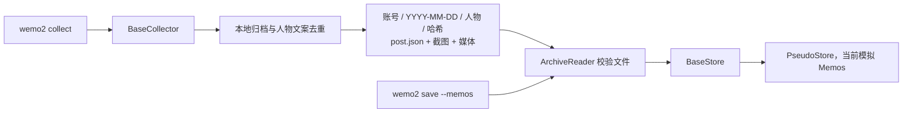
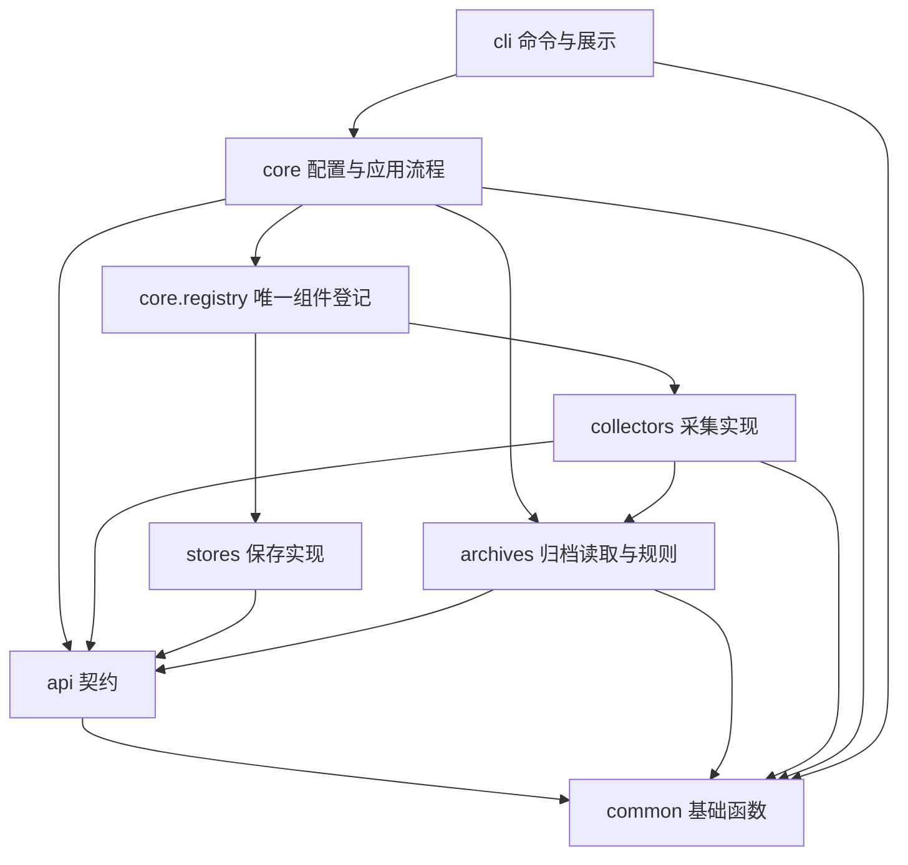

# wemo2 架构

## 两阶段流程

采集器内完成本地去重归档；存储器消费已采集的文件夹。两个命令可分开运行，不依赖同一进程、内存对象或微信会话。

删除旧的 BaseDeduplicator、Deduplicator/PseudoDeduplicator 和 Coordinator；不再输出 Observation 给独立去重服务，也不再用 SQLite 保存同一采集流程。原 wemo2_collector 包已经合并到 wemo2.collectors。

## 组件与边界

| 功能包 | 主要模块与职责 |
| --- | --- |
| api/ | interfaces.py 定义 BaseCollector/BaseStore；records.py 定义 post.json 契约；models.py 定义 CollectResult/ArchivedPost/SaveResult |
| core/ | config.py 加载配置；registry.py 唯一登记组件；services.py 分别执行采集和保存 |
| cli/ | commands.py 维护 Typer 命令；runtime.py 处理命令运行、日志与退出码；console.py 用 Rich 展示结果 |
| collectors/ | Windows UI 操作、OCR、媒体保存、拼接及归档合并；pseudo.py 提供离线示例采集 |
| stores/ | pseudo.py 实现内存保存；未来 Memos 实现放在这里 |
| archives/ | identity.py 维护人物文案哈希；paths.py 维护布局与旧目录升级；reader.py 校验归档及资源 |
| common/ | 人物名与目录名规范、路径范围检查、文件哈希、原子 JSON 写入及文件日志 |

api 是 Python 接口与数据契约，不是 HTTP 服务。根 main.py、包 __main__.py 和安装后的 wemo2 命令统一调用 cli.commands.main。

窗口、模板、主题和路由只位于 collectors 内。应用层通过 core.registry 组装，不导入采集私有模型。存储器取得的是已经校验的 ArchivedPost，包括元信息及真实文件路径；不再次做人物文案去重，也不从窗口截图解析信息。

依赖保持单向：api/common 不反向导入业务流程或具体组件，archives/stores 不导入采集实现。core 不依赖 Rich/Typer；CLI 运行器调用 core.services，处理终端提示和退出。common 不存放朋友圈身份和目录层级规则，这些规则属于 archives。包边界由测试约束，避免后续重构重新混合职责。

## 本地归档契约

目录为 `resource_dir/account/YYYY-MM-DD/<去除 emoji 后的人物名>/<人物与完整文案的 SHA-256>/`。

每条至少留存 post.json 与 screenshot.png；已经成功下载的图片和视频放在 media 下，JSON 保存相对路径、大小和 SHA-256。未知日期使用 unknown_date；识别不完整使用 unidentified 标识，避免误去重。同账号同人物同完整文案复用目录，截图证据和媒体做增量合并，原文件不被覆盖。

识别裁剪边界 MomentDetails 属于采集私有模型；MomentRecord、ArchiveMedia、MomentEvidence 是可供保存阶段读取的共享元信息。未来跨进程无需传递 UI 类，只需读取 JSON 和同目录资源文件。

## 默认组合和配置

collect 默认使用 windows_screenshot；配置 collector=pseudo 可离线生成固定示例归档。两者都直接完成本地交付。

save 默认使用 pseudo；--memos 优先于配置的 store，选择注册名称 memos。当前 memos 映射 PseudoStore，并通过 notice 明确提示尚未上传。Memos 0.31 API 的实现留待下一阶段，不预先加入网络依赖、令牌、接口路径或请求逻辑。

配置优先级保持 CLI 显式参数 > 文件 > 默认值。resource_dir 和 account 在顶层共用；旧采集器选项中的同名字段可以提升迁移，但冲突会拒绝。截图专属路径只由采集配置解析。

## 成功、失败与后续实现

collect 失败时保留原始截图、已归档 JSON、已下载媒体和动作证据。save 遇到缺失、越界、损坏或不匹配的归档停止，不向存储器提交当前坏记录。存储异常不重发，命令退出非零，终端只展示简短错误和日志路径；已完成的其他记录不因此删除。

本次模拟保存只验证流程与数据交付，不产生远端幂等回执或持久化保障。未来接入 Memos 时，在 stores 新增 BaseStore 实现并在 core/registry.py 登记；存储端仍需处理自身的上传回执、网络中断与重复运行，但不恢复独立的朋友圈去重器。

采集内部的 UiController、UiProfile、Airtest 匹配、Win32 保存控件和图片切换策略保持现有职责，详见 collectors/ARCHITECTURE.md。

人物清洗由 common.names.normalize_person 统一执行，OCR 输出、MomentRecord 和 archives.identity.moment_key 使用相同规则。person_raw 保留原始人名，不参与哈希；朋友圈正文不移除 emoji。目录名通过 person_directory 避开路径分隔符、控制字符和 Windows 保留设备名。只含 emoji 或未识别人名的归档位于 unknown_person 下，仍不生成稳定身份键。

archives.paths 同时枚举新旧两种布局，旧归档按清洗后的身份键匹配，并在再次采集时升级为日期/人物/哈希目录；先检查路径处于配置账号目录中，再移动整个朋友圈文件夹、更新元信息身份键，截图和媒体相对引用保留。目标存在或已有多个相同身份的目录时停止，不覆盖已有资源。

共用文件操作从实际重复代码提取：采集、目录升级与离线示例通过 common.files.write_model_json 写元信息；媒体下载、采集归档及保存读取通过 sha256_file 计算真实文件哈希；所有资源范围检查复用 common.paths。这里只保证单个 JSON 的原子替换，不提供整个归档事务或跨进程锁。本次按用户选择不增加三方依赖，候选包和适用条件见 doc/code-organization.md。
