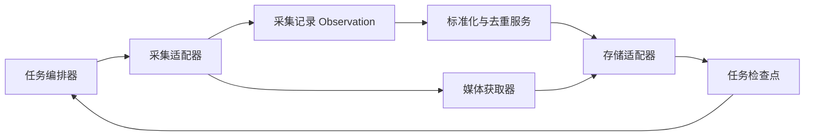

# wemo2 架构草案

版本：`0.1.0`。状态：完整目标契约草案，已有最小本地实现。

当前实现范围：`JsonCollector` 读取 Observation 数组，`Deduplicator` 使用 Observation ID 和稳定源 ID 去重，`SQLiteStore` 原子保存采集记录、动态和修订，`Coordinator` 按记录串联处理。可通过 Tkinter 或命令行导入。尚未实现下文完整的分页、媒体、候选审核、检查点及远端同步契约；无稳定源 ID 时保留独立记录，合并仅处理顶层字段完整度。Windows/Android 真实采集器及 Memos 适配器尚未实现。

wemo2 是朋友圈备份工具，分为自动采集、去重、持久化三个独立模块。本文先定义与语言、框架、采集技术和存储位置无关的数据契约；视觉识别、控件访问、数据库读取均作为可替换的采集适配器。

首版技术选型：Python 3.12+，使用 uv 管理项目和依赖，Loguru 记录日志，Tkinter 提供桌面交互。首版采集源为 Windows 微信，后续增加 Android 采集适配器；平台差异封装在 Collector 内，继续使用本文的 JSON 契约。

最终持久化与展示目标为 Memos，通过 Memos 适配器保存动态与媒体并利用其界面展示。具体 API、认证和字段映射在接入时按部署版本确认。Memos 未必直接提供本文要求的事务、身份索引和检查点，因此本地状态库负责幂等、修订、待办和检查点，Memos 写入通过持久化待办重试并记录远端 ID。一次本地提交不等于 Memos 同步完成，任务结果需单独报告同步状态。当前已实现最小 SQLite 本地存储，尚未实现 Memos 适配器。

## 1. 模块边界

当前 Python 代码使用 `interfaces.py` 的 `BaseCollector`、`BaseDeduplicator`、`BaseStore`
三个 ABC 抽象类。`Coordinator` 只依赖这些契约，通过构造函数注入具体实现；
`composition.build_coordinator()` 是选择并组装实现的入口，协调器本身不做模拟。

流程演示提供 `PseudoCollector`（内置模型记录）、`PseudoDeduplicator`（Observation ID 幂等）、
`PseudoStore`（内存保存、修订和失败回滚）。采集器默认产生两条动态与一次重复投递，
同一个协调器可替换为 JSON 采集、稳定源 ID 去重或 SQLite 存储，也支持混合组合。
模拟存储是单线程演示工具，不提供跨进程持久化和并发保证。



| 模块 | 输入 | 输出 | 职责 |
| --- | --- | --- | --- |
| 任务编排器 | 采集任务、检查点 | 执行结果 | 调度、重试、串联处理、推进游标 |
| 采集适配器 | 范围、游标、数量限制 | Observation 批次、下一游标 | 从具体数据源读取，不负责最终去重或存储 |
| 标准化与去重服务 | Observation、已有索引 | 身份匹配、内容合并、保存结果 | 判断同一条动态、保留修订、执行幂等写入 |
| 媒体获取器 | 临时媒体引用 | 字节流、下载状态 | 将图片、视频等交给存储层，不把大文件塞进 JSON |
| 存储适配器 | 动态、采集记录、媒体、检查点 | 持久化回执 | 封装本地文件、数据库、对象存储或云端实现 |

模块可运行在同一进程，也可通过 HTTP、消息队列或标准输入输出连接。本文的操作名是逻辑接口，不规定网络协议。

## 2. 通用数据约定

Python 实现以 `src/wemo2/models.py` 中的 Pydantic 模型为数据定义，JSON 是它们的外部序列化形式。
已定义 Observation、Source、Content、Author、Media、Comment、Reaction、Post、Decision 和 RunResult 等结构。
时间字段使用带时区的 datetime，导入时校验必填项、字段状态、媒体结构及稳定源 ID 的关联约束。
序列化使用 `exclude_unset=True` 保留字段缺失语义，旧数据库的 Observation 通过模型解析后比较，兼容时间字符串格式变化。

当前 `JsonCollector(path)` 接收文件路径，文件中的数组代表一批 Observation，用于导入已有或模拟记录。
抽象采集接口 `collect() -> Iterable[Observation]` 的输出不依赖文件格式；未来 Windows/Android 采集器可直接逐条产生模型对象。

- JSON 字段使用 `snake_case`；所有消息携带 `schema_version`。
- ID 均为字符串；内部 ID 使用 UUID 或同等唯一标识，不依赖某种数据库自增值。
- 时间采用带时区的 RFC 3339 字符串；存储时统一 UTC。无法获取的字段为 `null`，不能伪造发布时间或用户 ID。
- `account_scope` 表示一个备份账号的独立命名空间。不同账号的动态默认不跨域合并。
- 用户、动态、评论的源 ID 只有在采集器明确声明稳定且作用域已知时，才作为强身份依据。
- 字段缺失或 `null` 表示未观察到；空数组只有在字段标记为 `complete` 时才表示“确实为空”。
- `extensions` 用于适配器专属信息；核心模块不得依赖它完成基本工作。
- 所有例子均为虚构数据；访问凭证由实现侧配置，不能写入动态或任务 JSON。

## 3. 核心数据结构

### 3.1 Observation：一次采集得到的事实

Observation 是追加保存的采集记录。相同动态可以有多次 Observation；采集重试必须复用同一个 `observation_id`，真正的新观察使用新 ID。

```json
{
  "schema_version": "0.1.0",
  "observation_id": "obs-001",
  "account_scope": "account-local-001",
  "collector_id": "wechat-ui-local",
  "run_id": "run-001",
  "observed_at": "2026-10-10T13:00:00Z",
  "source": {
    "platform": "wechat_moments",
    "method": "ui",
    "instance_id": "device-local-001",
    "native_post_id": null,
    "native_id_namespace": null,
    "native_post_id_stable": false
  },
  "content": {
    "author": {
      "native_user_id": null,
      "native_user_id_namespace": null,
      "native_user_id_stable": false,
      "display_name": "示例用户"
    },
    "published_at": null,
    "published_time": {
      "raw": "今天",
      "precision": "day",
      "earliest": "2026-10-09T16:00:00Z",
      "latest_exclusive": "2026-10-10T16:00:00Z"
    },
    "text": "今天去看海。",
    "location": null,
    "link": null,
    "media": [
      {
        "attachment_key": "attachment-001",
        "kind": "image",
        "position": 0,
        "source_asset_id": null,
        "source_ref": "collector://wechat-ui-local/media/attachment-001",
        "rendition": "thumbnail",
        "mime_type": "image/jpeg",
        "sha256": null
      }
    ],
    "comments": [],
    "reactions": []
  },
  "field_status": {
    "author": "partial",
    "published_at": "unknown",
    "text": "complete",
    "media": "partial",
    "comments": "unknown",
    "reactions": "unknown"
  },
  "evidence": [
    { "kind": "screenshot", "storage_ref": "blob://evidence/example-001" }
  ],
  "extensions": {}
}
```

`method` 建议值：`vision`、`ui`、`database`、`import`。`field_status` 取 `unknown`、`partial`、`complete`，状态含义由采集器保证；视觉误识别等问题可在 `extensions` 记录置信度和位置。

`published_at` 只存已知的精确时间；相对时间保留原文和可推断区间。媒体的 `source_ref` 是采集器可解析的临时引用，可能过期，不能当永久备份地址。

评论建议结构：`{comment_id, native_comment_id, author, text, published_at, reply_to}`；反应建议结构：`{reaction_id, type, actor}`。内部子项 ID 由去重服务分配。没有稳定源 ID 时，不凭昵称和相同文本自动合并评论。

### 3.2 Post：合并后的动态

```json
{
  "schema_version": "0.1.0",
  "account_scope": "account-local-001",
  "post_id": "post-001",
  "revision": 1,
  "content": {
    "author": { "author_id": "author-001", "display_name": "示例用户" },
    "published_at": null,
    "published_time": {
      "raw": "今天",
      "precision": "day",
      "earliest": "2026-10-09T16:00:00Z",
      "latest_exclusive": "2026-10-10T16:00:00Z"
    },
    "text": "今天去看海。",
    "location": null,
    "link": null,
    "media": [
      {
        "attachment_id": "attachment-001",
        "position": 0,
        "kind": "image",
        "rendition": "thumbnail",
        "asset_id": null,
        "state": "pending"
      }
    ],
    "comments": [],
    "reactions": []
  },
  "identity_keys": [],
  "fingerprints": {
    "algorithm": "post-content-v1",
    "value": null
  },
  "field_status": { "text": "complete", "media": "partial" },
  "provenance": { "text": "obs-001", "media": "obs-001" },
  "observation_ids": ["obs-001"],
  "first_seen_at": "2026-10-10T13:00:00Z",
  "last_seen_at": "2026-10-10T13:00:00Z",
  "availability": "unknown"
}
```

`author_id` 是内部身份，昵称不构成唯一身份。稳定源用户 ID 可映射到内部身份；无法确定时保留独立身份和待确认候选。

`revision` 在合并内容或附件状态发生变化时递增；单纯更新最后观察时间不必创建内容修订。保留旧修订和字段来源，冲突不能通过覆盖原始 Observation 消失。`availability` 可取 `unknown`、`visible`、`unavailable`；采集不到不能直接解释为已删除。

### 3.3 Asset：实际备份的媒体

```json
{
  "schema_version": "0.1.0",
  "account_scope": "account-local-001",
  "asset_id": "asset-001",
  "sha256": "aaaaaaaaaaaaaaaaaaaaaaaaaaaaaaaaaaaaaaaaaaaaaaaaaaaaaaaaaaaaaaaa",
  "byte_size": 123456,
  "mime_type": "image/jpeg",
  "storage_ref": "blob://assets/asset-001",
  "stored_at": "2026-10-10T13:01:00Z"
}
```

上例哈希为占位示意，真实哈希由已获取的字节计算。附件状态取 `pending`、`stored`、`failed`、`unavailable`。原图、缩略图和视频封面是不同版本，不能相互冒充；同一文件可被多个附件引用。

## 4. 采集接口 Collector

```text
describe() -> CollectorCapabilities
collect(CollectRequest) -> CollectBatch
open_media(MediaRequest) -> MediaStream
```

`describe()` 返回 `collector_id`、支持的数据字段、`can_resume`、`can_fetch_media`、`stable_post_ids`、`ordering`。数据源不具备的能力应显式声明；接口不保证某个微信版本能使用某种采集方法。

请求：

```json
{
  "schema_version": "0.1.0",
  "run_id": "run-001",
  "account_scope": "account-local-001",
  "range": { "since": null, "until": null, "author_ids": [] },
  "cursor": null,
  "limit": 50,
  "include": { "media": true, "comments": true, "reactions": true }
}
```

响应外壳，`observations` 中的元素遵循 3.1：

```json
{
  "schema_version": "0.1.0",
  "batch_id": "batch-001",
  "observations": [],
  "next_cursor": "opaque-collector-cursor",
  "has_more": true,
  "coverage": "partial",
  "warnings": [],
  "errors": []
}
```

- 游标是不透明字符串，只由同一个采集器解析，并绑定账号、查询范围及游标版本。
- `has_more=false` 仅表示本次遍历结束；`coverage` 取 `complete`、`partial`、`unknown`，描述请求范围的实际覆盖情况。
- 无法可靠续采的视觉/UI 实现可重新扫描近期范围，由后续去重消除重复；游标失效返回明确错误。
- `open_media` 输入包含 `account_scope`、`observation_id`、`attachment_key`、`source_ref`；输出字节流及 MIME 类型等元信息。跨进程可使用二进制 HTTP 响应或临时下载地址。

## 5. 标准化与去重接口 Resolver

```text
normalize(observation) -> NormalizedObservation
resolve(normalized_observation, store) -> MatchDecision
ingest(observation, store) -> IngestResult
```

`normalize`、`resolve` 不写入数据。`ingest` 是编排器调用的主接口，完成标准化、匹配、合并和原子保存；实际写入由存储适配器负责。

```json
{
  "schema_version": "0.1.0",
  "observation_id": "obs-001",
  "post_id": "post-001",
  "action": "created",
  "match": { "rule": "new", "confidence": 1.0, "candidate_post_ids": [] },
  "revision": 1,
  "pending_media": ["attachment-001"]
}
```

`action`：`created`、`merged`、`unchanged`、`needs_review`。`needs_review` 也要持久化：保存独立的临时 Post 和匹配候选，等待后续证据或人工确认；不能丢弃记录或推进游标前留在内存中。

### 5.1 匹配规则，按优先级执行

1. **请求幂等**：相同 `(account_scope, observation_id)` 返回已有回执。相同 ID 携带不同负载返回 `IDEMPOTENCY_CONFLICT`。
2. **强身份匹配**：使用 `(account_scope, platform, native_id_namespace, native_post_id)`。只有稳定源 ID 可参与；相同动态内容变化时产生修订，不创建新动态。
3. **内容候选匹配**：无源 ID 时，使用作者身份、发布时间或区间、正文、媒体及其顺序查找候选。内容完全相同仍可能是同一作者重复发布，因此内容哈希不能单独作为唯一约束。v0.1 对无强身份依据的匹配默认进入待确认，后续可配置保守的自动合并策略。
4. **模糊候选匹配**：OCR 差异、时间模糊、缺失媒体仅用于推荐候选，不自动合并。置信度描述规则判断，不能当作校准后的概率。

标准化保留原文，并生成匹配用文本：统一 Unicode NFC 和换行，去除首尾空白，保留表情、标点和正文内部空白。指纹采用 SHA-256，对明确字段投影执行固定键序 JSON 序列化；记录算法版本，排除采集时间、下载地址、昵称变化、评论和点赞。媒体内容哈希存在时优先使用，临时 URL 不能充当文件身份。

### 5.2 合并规则

- `unknown` 或 `partial` 的新值不能清空已有完整字段；完整数据可以补全缺失信息。
- 强身份相同且完整字段发生变化时，保留新旧修订及来源；来源矛盾时记录冲突，v0.1 不默认认定某种采集技术总是更可靠。
- 评论、点赞不参与动态身份判断。新增可合并；删除只有在明确完整快照和可比较子项身份时才能推断，否则保留旧项及观察记录。
- 文件按实际字节哈希去重，不按文件名或下载 URL 去重；无强身份的动态宁可保留待确认副本。

## 6. 持久化接口 Store

```text
get_post(account_scope, post_id) -> Post | null
find_candidates(account_scope, identity_keys, fingerprints, hints) -> Post[]
get_ingest_receipt(account_scope, observation_id) -> IngestResult | null
commit_ingest(observation, post_change, identity_bindings,
              review_candidates, receipt, expected_revision) -> IngestResult
put_asset(account_scope, bytes, metadata) -> Asset
link_asset(account_scope, post_id, attachment_id, asset_id, expected_revision) -> Post
get_checkpoint(account_scope, collector_id, query_key) -> Checkpoint | null
save_checkpoint(checkpoint, expected_checkpoint_version) -> Checkpoint
```

`commit_ingest` 必须将 Observation、Post/修订、身份索引、待确认候选、幂等回执及媒体待办作为一个原子提交。数据库可用事务；文件实现可用单写者、日志与原子替换达到同样的可恢复语义。`expected_revision` 提供乐观锁；冲突后重新读取并执行匹配/合并，不能覆盖另一写者的结果。

稳定身份键和 Observation ID 都需唯一约束。内容指纹是非唯一索引。首次创建时，同一强身份被并发插入也必须检测冲突并重试；v0.1 默认每个账号一个写入任务。

`put_asset` 只有字节持久化且校验通过后才返回成功；按 `(account_scope, sha256)` 幂等。`link_asset` 更新附件引用及状态，保留修订。媒体上传与元数据提交无法组成一个事务时，先保存文件再关联；崩溃产生的孤立文件通过延迟清理回收，待办重试可复用已存在的文件。

检查点示例：

```json
{
  "schema_version": "0.1.0",
  "account_scope": "account-local-001",
  "collector_id": "wechat-ui-local",
  "query_key": "recent-all-v1",
  "cursor": "opaque-collector-cursor",
  "last_committed_batch_id": "batch-001",
  "checkpoint_version": 1,
  "updated_at": "2026-10-10T13:02:00Z"
}
```

`query_key` 是账号、范围、采集选项及配置版本的稳定摘要。检查点只在整个批次的所有 Observation 已成功提交后推进。媒体可尚未完成，但其待办与临时引用必须已持久化；元数据采集完成和媒体备份完成应分别报告。

## 7. 一次自动采集流程

```text
读取能力、配置及检查点
循环：
    batch = collector.collect(request_with_saved_cursor)
    对 batch 中每条 observation：
        result = resolver.ingest(observation, store)
        确认回执和媒体待办已经持久化
    确认没有未处理的采集错误或未保存的记录
    store.save_checkpoint(batch.next_cursor)
    若 batch.has_more == false：结束本次遍历
媒体工作器读取持久化待办：
    stream = collector.open_media(pending_media)
    asset = store.put_asset(stream)
    store.link_asset(post, attachment, asset)
    更新待办状态，失败则记录原因并重试
```

采用至少一次投递：崩溃后允许重放整个批次，以 Observation 幂等和身份匹配控制重复。采集器应尽可能在重放时复用 Observation ID；做不到时强身份仍可去重，无强身份则进入候选处理。单条失败时不跳过该批次，重试时已提交记录返回原回执。

## 8. 错误、恢复与备份完整性

统一错误结构：

```json
{
  "code": "SOURCE_UNAVAILABLE",
  "message": "当前采集源不可访问",
  "retryable": true,
  "retry_after_ms": 5000,
  "context": { "run_id": "run-001", "observation_id": null }
}
```

建议错误码：`AUTH_REQUIRED`、`SOURCE_UNAVAILABLE`、`CURSOR_EXPIRED`、`PARSE_FAILED`、`MEDIA_UNAVAILABLE`、`STORAGE_FAILED`、`REVISION_CONFLICT`、`IDEMPOTENCY_CONFLICT`、`SCHEMA_UNSUPPORTED`。

可重试错误使用有上限的指数退避；认证缺失等待用户处理，游标过期从重叠范围重采，媒体永久不可获取则保留 `unavailable` 状态及原因。任务结果应记录动态数量、待确认数量、媒体成功/失败/待处理数量、覆盖范围和检查点，不能把缺少媒体的备份报告为完整。

原始记录、证据和媒体可能包含私人信息。适配器只读取用户授权的账号数据，日志避免正文及凭证；本地权限、云端认证、加密和导出策略由具体部署配置。保留原始记录和修订会增加容量，应提供可配置的保留策略，并保证删除文件前检查引用。

## 9. 最小可运行实现建议

这是一条建议落地路线，接口不绑定以下技术：

1. 先实现 `JsonImportCollector`，读取符合 3.1 的 JSON 文件，验证模块之间能互换数据。
2. 使用 SQLite 保存 Observation、Post、修订、身份索引、回执、媒体待办和检查点；媒体保存到本地 `assets/`，按哈希组织。
3. 实现强身份去重、Observation 幂等、文件哈希去重和待确认候选；先不实现自动模糊合并。
4. 编排器支持手动执行和周期执行；接入 Windows 采集器和 Memos 适配器，后续扩展 Android。耗时采集与同步运行在工作线程，Tkinter 主线程通过队列接收进度，避免窗口阻塞。

实现阶段的验收场景：同一 Observation 重放不增量；同一源动态内容更新保留修订；同文不同源动态不误合并；部分采集不清空完整字段；进程在保存和推进游标之间中断可恢复；相同媒体重复下载只保存一份；媒体失败保留可重试待办；并发强身份写入只产生一条正式动态。

后续需要细化：各采集器的实际可用能力、身份确认机制、JSON Schema、评论/点赞子项契约、冲突处理界面，以及存储适配器的一致性测试。本草案不假定已具备访问微信数据库或完整朋友圈数据的能力。
