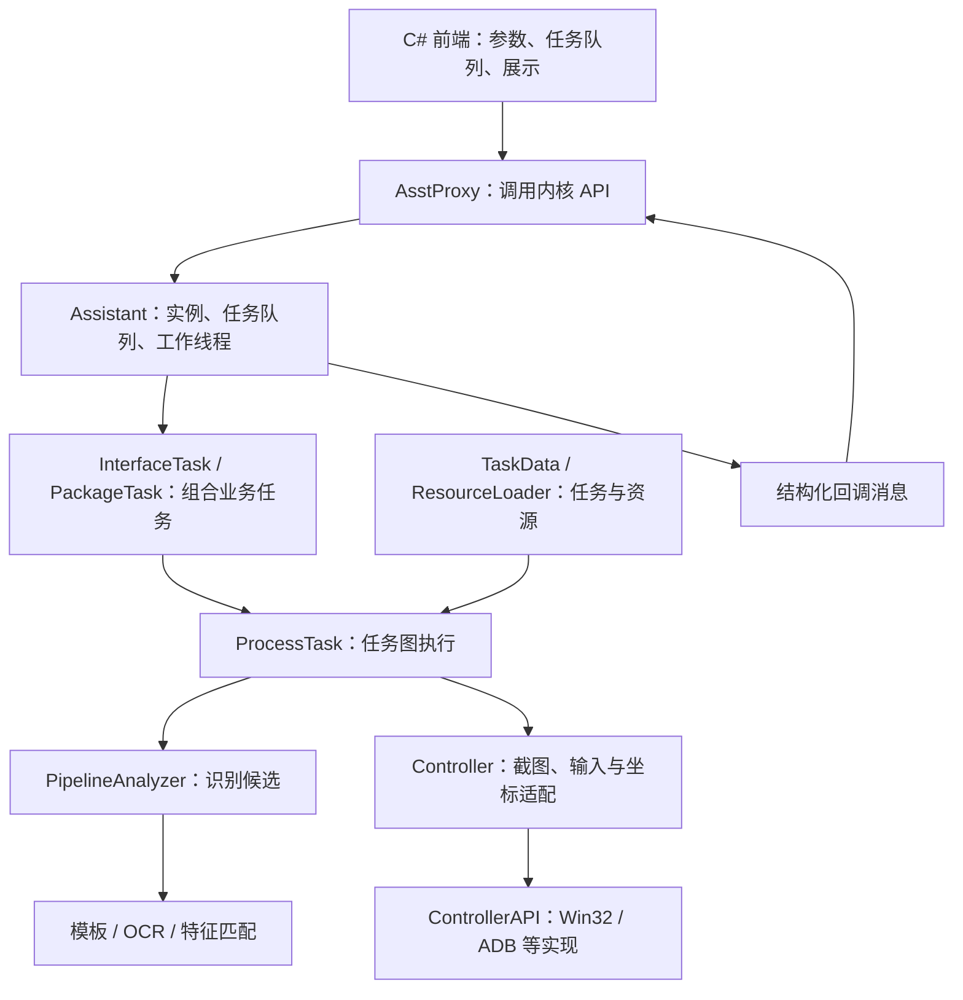
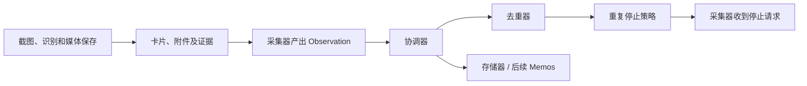

# 从 MAA 提炼适合 wemo2 的 UI 自动化架构

MAA 最值得借鉴的是：**用任务数据描述识别、动作和后续分支，让通用执行器维护运行规则；平台驱动、识别算法和交互界面各自保持边界。**

wemo2 已有相当一部分基础结构。下一步应补齐识别规则和媒体流程的数据定义、结构化失败结果、取消与进度传播，继续使用 Python、Pydantic、Airtest 和 RapidOCR。

## 1. 扫描范围与结论边界

- 扫描日期：2026-10-11，Asia/Shanghai。
- 本地参考仓库：`D:/Project/MaaAssistantArknights`，位于 wemo2 的同级目录。
- 本地 HEAD：`c7e8b263f9bfe78263fce1512e4774346438b846`。
- 重点阅读：MaaCore 任务执行、识别、平台控制、资源配置、事件回调，以及 MaaWpfGui 的任务模型和内核代理。
- 本文是上述源码的重点抽样阅读，不是全仓库逐文件审计，也不代表 MAA 所有版本的实现。
- 本次仅新增参考文档，没有修改 wemo2 实现、运行 MAA，或搬入 C++ / C# 代码。

下文每个主题区分“MAA 现有机制”和“wemo2 建议”。建议中的新增字段、资源文件和执行函数尚未实现，不能直接作为当前配置使用。

## 2. MAA 的主要分层



对应源码：

| 层次 | 主要职责 | 阅读入口 |
| --- | --- | --- |
| 交互边界 | 前端提交任务参数，接收内核回调并更新界面 | [AsstProxy.cs](D:/Project/MaaAssistantArknights/src/MaaWpfGui/Main/AsstProxy.cs:845) |
| 运行实例 | 任务入队、串行工作执行、停止、消息传递 | [Assistant.cpp](D:/Project/MaaAssistantArknights/src/MaaCore/Assistant.cpp:303) |
| 业务组合 | 组合子任务、传递任务 ID 和运行设置 | [PackageTask.cpp](D:/Project/MaaAssistantArknights/src/MaaCore/Task/PackageTask.cpp) |
| 任务图 | 识别节点、执行动作、选择后继、计数和失败分支 | [ProcessTask.cpp](D:/Project/MaaAssistantArknights/src/MaaCore/Task/ProcessTask.cpp:143) |
| 识别 | 在同一图像中按配置查找候选，返回识别结果和矩形 | [PipelineAnalyzer.cpp](D:/Project/MaaAssistantArknights/src/MaaCore/Vision/Miscellaneous/PipelineAnalyzer.cpp) |
| 平台控制 | 截图、输入、坐标缩放及平台能力 | [ControllerAPI.h](D:/Project/MaaAssistantArknights/src/MaaCore/Controller/ControllerAPI.h) |
| 资源 | 加载任务、模板及 OCR 资源，维护资源版本标识 | [ResourceLoader.cpp](D:/Project/MaaAssistantArknights/src/MaaCore/Config/ResourceLoader.cpp:91) |

这些层次是职责划分，不要求 wemo2 为每一层新增类或抽象接口。

## 3. 最值得借鉴的机制

### 3.1 任务数据描述流程，执行器维护统一规则

**MAA 现有机制**

[任务流程协议](D:/Project/MaaAssistantArknights/docs/zh-cn/protocol/task-schema.md:18) 定义任务节点，其中包括：

| 字段 | 含义 | 对 wemo2 的价值 |
| --- | --- | --- |
| `algorithm` | 模板、OCR、特征匹配或直接返回 | 识别方式由目标配置选择 |
| `action` | 点击匹配位置、输入、滑动、等待或停止等 | 动作语义与平台实现分离 |
| `next` | 按顺序识别后继候选，执行第一个命中的节点 | 允许按当前界面状态选择后续流程 |
| `onErrorNext` | 重试耗尽后的后继候选 | 明确定义失败后的处理入口 |
| `maxTimes` / `exceededNext` | 执行上限及超限分支 | 防止任务图无限循环 |
| `roi` | 识别区域 | 减少误匹配与计算范围 |
| `preDelay` / `postDelay` | 输入前及输入后的等待 | 统一时间参数 |

注意：`next: [A, B]` 表示有序候选，不表示依次执行 A、B。串行子任务由其他组合机制承担，协议也提醒不要滥用嵌套 `sub`。

[ProcessTask::run](D:/Project/MaaAssistantArknights/src/MaaCore/Task/ProcessTask.cpp:143) 根据 `Success`、`RetryFailed`、`Runout`、`Interrupted` 等结果选择后继，而非让每个业务任务自行维护整个流程。

**wemo2 建议**

现有 [UiProfile](D:/Project/wemo2/src/wemo2/collectors/profiles.py) 已集中定义页面和导航，但 [MediaCapture](D:/Project/wemo2/src/wemo2/collectors/media.py:69) 仍在函数中硬编码查看器、右键、另存为和返回流程。

先将这条媒体流程拆成少量数据步骤，共用 `UiController` 的执行、验证和证据能力。验证型步骤完成后才进入下一步；`ActionResult.executed` 不等于业务成功。

MAA 的候选优先匹配适合已知优先级的场景；wemo2 的点击目标仍应拒绝歧义。同一锚点出现多个实例是正常的多目标识别，不能与点击目标的唯一性规则混用。

### 3.2 将识别规则也纳入资源定义

**MAA 现有机制**

[TaskData](D:/Project/MaaAssistantArknights/src/MaaCore/Config/TaskData.cpp:296) 加载任务定义；[PipelineAnalyzer](D:/Project/MaaAssistantArknights/src/MaaCore/Vision/Miscellaneous/PipelineAnalyzer.cpp) 根据任务算法调用匹配或 OCR。任务配置描述 ROI、模板阈值、OCR 文本要求等，而不是仅保存图片路径。

**wemo2 建议**

扩展现有 `UiProfile`，集中维护模板和文字目标。可以用 Pydantic 的带类型标签模型区分模板规则与 OCR 规则；外部交互继续使用 TOML。

需要集中维护的现有规则包括：

- [MediaCapture](D:/Project/wemo2/src/wemo2/collectors/media.py:69) 中的另存为候选文字、OCR 阈值和查看器范围。
- [TextRecognizer.nickname](D:/Project/wemo2/src/wemo2/collectors/recognition.py:62) 中的顶部范围、头像相对位置、昵称颜色约束。
- [media_tiles](D:/Project/wemo2/src/wemo2/collectors/recognition.py:105) 中的媒体块尺寸、背景和布局参数。

OpenCV、RapidOCR 继续负责算法；微信版本、主题和布局参数由采集资源负责。

未来资源可以按 `windows/dark`、`windows/light`、`android/...` 区分，只有准备了对应样本和验证用例才能宣称支持。不要根据没有验证的主题自动猜参数。

### 3.3 一帧用于多个只读识别，输入仍验证新鲜度

**MAA 现有机制**

[ProcessTask::find_first](D:/Project/MaaAssistantArknights/src/MaaCore/Task/ProcessTask.cpp:229) 获取一张图像，然后将候选列表交给识别管线；`HitDetail` 同时保留图像、识别结果、矩形和任务定义。

[PipelineAnalyzer](D:/Project/MaaAssistantArknights/src/MaaCore/Vision/Miscellaneous/PipelineAnalyzer.cpp) 可以通过 `Status` 缓存目标 ROI。协议明确指出，这类位置缓存只适用于目标位置不会变化的任务。

**wemo2 建议**

使用当前 `Screenshot.frame_id` 作为只读识别缓存的边界。同一帧的页面标志、锚点和 OCR 可以复用加载后的图像，减少 [AirtestLocator](D:/Project/wemo2/src/wemo2/collectors/locating.py) 的重复文件读取。

区分三种缓存：

| 缓存 | 是否适合复用 | 失效条件 |
| --- | --- | --- |
| 模板文件 / OCR 引擎 | 可以跨帧复用 | 资源版本或模型改变 |
| 单帧识别结果 | 只用于该帧的只读分析 | `frame_id` 改变 |
| 固定控件 ROI | 作为下一帧识别的搜索提示 | 页面、窗口、DPI、主题或资源版本改变 |

动态列表滚动后不复用旧锚点坐标。输入仍检查帧时效、目标归属、窗口范围和内容连续性。缓存命中不能绕过这些检查。

### 3.4 平台驱动暴露能力，任务无需猜平台

**MAA 现有机制**

[ControllerAPI](D:/Project/MaaAssistantArknights/src/MaaCore/Controller/ControllerAPI.h) 定义截图、点击、输入、滑动和 `support_features()`；Win32、ADB 等实现提供平台行为。[ControlScaleProxy](D:/Project/MaaAssistantArknights/src/MaaCore/Controller/ControlScaleProxy.h) 集中处理坐标尺度和输入适配。

**wemo2 建议**

保留现有 `BaseDriver`。增加 Android 时，按实际实现声明截图、触摸滑动、滚轮、右键、保存对话框等能力，启动流程前检查所需能力。

Windows 的滚轮不能被解释为 Android 的触摸滑动；Windows 的右键另存为也不应出现在通用 Android 工作流中。公共的是“保存媒体”的业务目标，平台流程可以不同。

无需现在增加所有 Android 方法。能力声明可以是简单枚举集合或 Pydantic 数据，不必新增一组能力接口类。

继续区分截图局部物理坐标、平台屏幕坐标及模板参考 DPI。MAA 的游戏基准分辨率缩放策略不直接套用到微信客户区。

### 3.5 运行结果和事件分离，前端只消费结构化信息

**MAA 现有机制**

[AsstMsg.h](D:/Project/MaaAssistantArknights/src/MaaCore/Common/AsstMsg.h) 区分任务链和子任务的开始、完成、错误与停止。[Assistant](D:/Project/MaaAssistantArknights/src/MaaCore/Assistant.cpp:552) 执行任务并传递消息；[AsstProxy.CallbackFunction](D:/Project/MaaAssistantArknights/src/MaaWpfGui/Main/AsstProxy.cs:845) 解析回调 JSON，将处理派发到 UI 线程。

**wemo2 建议**

以已有 `ActionResult` 为事实记录，补充少量阶段事件：步骤开始、步骤完成、识别失败、媒体保存、采集停止。事件包含运行 ID、步骤名、帧 ID、状态、错误码和证据引用。

Rich CLI 消费这些事件显示进度，Loguru 记录详细日志。将来增加 Tkinter 时仍消费同一事件，不把窗口定位或截图字段加入 `wemo2.AppConfig`。

保持动作结果、日志和进度三者用途明确。停止原因应使用结构化值，不依赖当前 [FeedCapture](D:/Project/wemo2/src/wemo2/collectors/feed.py:136) 对中文错误字符串前缀的判断。

第一版可使用普通回调函数；没有跨线程需求时不引入事件总线或消息队列。

### 3.6 区分识别重试、任务重试与输入执行事实

**MAA 现有机制**

[ProcessTask::find_and_run_task](D:/Project/MaaAssistantArknights/src/MaaCore/Task/ProcessTask.cpp:439) 在识别失败时重试，找到节点后执行动作；[AbstractTask::run](D:/Project/MaaAssistantArknights/src/MaaCore/Task/AbstractTask.cpp:31) 另有整个 `_run()` 的重试机制。

这两种重试的粒度不同。MAA 的 `run_action()` 对多数动作返回 `Success`，后续任务识别再推动流程；它不等同于 wemo2 对每次动作维护的 `attempted/executed/verified` 契约。

**wemo2 建议**

- 识别失败：有限次数重新截图、定位。
- 输入已尝试：保留 `attempted`，异常时不自动重发。
- 输入已返回但后置条件未满足：继续只读观察，超时记录已执行事实。
- 明确成功：验证后置条件，再进入下一步。
- 达到滚动上限、没有进展、用户取消：各自记录停止原因，不统一当作历史记录到底。

失败分支应优先保存现场、结束流程或请求人工处理。自动补救步骤也需要明确前置条件、输入次数限制和新的后置验证。

### 3.7 缓存失败现场、支持协作式取消

**MAA 现有机制**

[InterfaceTask](D:/Project/MaaAssistantArknights/src/MaaCore/Task/InterfaceTask.h) 提供 `save_fail_img()`，使用缓存帧保存失败现场，避免诊断时再次触发截图。[InstHelper](D:/Project/MaaAssistantArknights/src/MaaCore/InstHelper.cpp) 提供 `need_exit()` 和可检查退出状态的等待；任务执行中也检查退出请求。

**wemo2 建议**

失败时先保留已获取的 `Screenshot` 和 `ActionResult`。不能为了补充错误截图又重放点击、重新激活其他窗口或重复下载。

在滚动前、开始媒体保存前、每次等待轮询前检查取消标记。取消只发出请求，资源在采集流程的 `finally` 中释放；不要在输入进行中由另一个调用直接关闭驱动。

原生文件保存已经开始时，取消后的状态仍应说明是否存在文件、是否完成验证。用户取消不是“采集成功”或“保存未发生”。

### 3.8 资源校验和覆盖规则必须可追踪

**MAA 现有机制**

[ResourceLoader](D:/Project/MaaAssistantArknights/src/MaaCore/Config/ResourceLoader.cpp:91) 集中加载任务、模板和 OCR 资源，加载结束更新资源 UUID。[TaskData](D:/Project/MaaAssistantArknights/src/MaaCore/Config/TaskData.cpp:70) 支持任务继承和多文件覆盖，部分深层校验位于 `ASST_DEBUG` 条件中。

**wemo2 建议**

先采用“内置资源 + 明确的用户覆盖”两层，记录所用资源版本或摘要。启动时始终验证目标引用、模板存在性、ROI、算法字段、动作能力和步骤上限；正常运行也不能跳过校验。

同名覆盖是显式替换还是逐字段继承，需要制定唯一规则。第一版可以采用完整替换，避免维护 MAA 的 `baseTask`、`@`、`#` 和表达式系统。

## 4. 对应 wemo2 的职责结构

| wemo2 现有部分 | 借鉴后的职责 | 是否需要新增抽象 |
| --- | --- | --- |
| `UiProfile` | 页面、主题、识别规则及小型步骤定义的唯一维护处 | 扩展数据结构即可 |
| `AirtestLocator` / `TextRecognizer` | 模板与 OCR 执行适配，返回有帧归属的结果 | 保留具体实现 |
| `UiController` | 输入、等待、验证、次数约束和证据记录 | 保留具体实现，必要时增加小型步骤执行函数 |
| `PageRouter` | 根据当前页面选择导航路径 | 保留现有职责 |
| `FeedCapture` | 滚动、重叠验证、锚点切分和采集上限 | 继续作为业务编排 |
| `MediaCapture` | 媒体候选和文件关联，读取配置步骤完成查看器流程 | 减少函数内硬编码 |
| `BaseDriver` / `WindowsDriver` | 平台输入、窗口验证及能力声明 | 保留唯一平台抽象，Android 有实现时再扩展 |
| `wemo2.Coordinator` | 消费 Observation、调用去重器及存储器、执行重复停止策略 | 不接触页面或模板 |

建议先扩展现有配置模型和函数。仅在出现第二种真实实现、调用方确实需要统一契约时增加抽象接口。

## 5. 媒体步骤定义的最小示意

下面是建议结构的 JSON 示例，**当前尚不支持加载此配置**。名称引用未来的语义目标，模板、OCR 文本和 ROI 分别在目标资源中定义。

```json
{
  "save_image": {
    "entry": "open_viewer",
    "max_steps": 8,
    "steps": {
      "open_viewer": {
        "target": "image_preview",
        "action": "click",
        "expect": "media_viewer_visible",
        "timeout_seconds": 5,
        "max_input_attempts": 1,
        "next": "open_menu",
        "on_error": "stop_with_evidence"
      },
      "open_menu": {
        "target": "viewer_content",
        "action": "right_click",
        "expect": "save_as_visible",
        "max_input_attempts": 1,
        "next": "choose_save_as",
        "on_error": "stop_with_evidence"
      },
      "choose_save_as": {
        "target": "save_as_text",
        "action": "click",
        "expect": "save_dialog_visible",
        "max_input_attempts": 1,
        "next": "write_file",
        "on_error": "stop_with_evidence"
      },
      "write_file": {
        "action": "save_file",
        "expect": "file_verified",
        "max_input_attempts": 1,
        "next": "return_to_feed",
        "on_error": "stop_with_evidence"
      },
      "return_to_feed": {
        "action": "close_viewer",
        "expect": "original_feed_visible",
        "max_input_attempts": 1,
        "next": "done",
        "on_error": "stop_with_evidence"
      }
    }
  }
}
```

示例的 `next` 是单一后继，与 MAA 的有序候选数组不同。`done` 和 `stop_with_evidence` 是约定的终止节点；正式实现需校验这些引用。

保存完成必须检查实际文件，返回完成必须检查原列表窗口和内容连续性。这些后置条件不能由等待时间替代。

窗口内查看器、独立查看器、视频查看器可以有不同的流程定义。只有具备对应识别证据时才选择其流程，不在通用执行器里增加微信版本分支。

## 6. 界面自动化任务与备份数据管线的边界

MAA 的任务完成表达的是游戏自动化步骤状态。wemo2 还需要数据完整度、真实附件、动态身份和持久化事实，不能用 UI 任务成功直接代表备份成功。

建议最终数据流保持：



当前 `WindowsScreenshotCollector` 仍返回空 Observation 列表。后续应在一条动态的数据足以形成明确观察事实后逐条产出，让协调器有机会反馈重复停止；不能先滚动并下载全部内容，最后才让去重器判断是否停止。

昵称和截图指纹不足以提供微信稳定动态 ID。无法确定的字段保留未知或不完整，原图、预览图和视频文件不能互相冒充。页面步骤定义始终留在 `wemo2.collectors`，应用只接收已有数据契约和通用进度信息。

## 7. 建议实施顺序

| 阶段 | 内容 | 验收标准 |
| --- | --- | --- |
| 1 | 将媒体 OCR 文本、布局和 ROI 参数纳入 `UiProfile`；合并匹配适配中的重复代码 | 新增主题规则不修改控制器，已有配置和入口兼容 |
| 2 | 媒体流程改为小型配置步骤，共用 `UiController`，补充结构化错误码 | 保存超时、返回失败都保留文件与 executed 事实；输入不重发 |
| 3 | 增加协作式取消、步骤进度和每次运行的上下文 | 取消后停止新输入，清单记录状态，资源最终释放 |
| 4 | 识别资源版本、单帧结果缓存、固定 ROI 缓存 | 换窗口、DPI、主题或资源时缓存失效；滚动不复用锚点位置 |
| 5 | 将卡片转换为逐条 Observation，打通去重反馈，再扩展 Android | 去重停止能阻止后续滚动；不支持的驱动能力启动前报错 |

推荐的验证场景：

- 输入发生前识别失败，平台输入调用次数为零。
- 输入执行后验证超时，调用次数仍为一，执行事实可追溯。
- 同一帧多个只读识别共用图像；新帧、窗口或 DPI 改变后旧结果不可用于输入。
- 文件保存完成但返回失败，文件、哈希和错误状态仍在证据中。
- 识别期间取消、保存期间取消、滚动前取消，各自有明确终态。
- 多候选歧义、非法步骤引用、不支持的平台能力和未配置主题，在执行前拒绝。
- 去重达到重复上限后，不再开始下一条动态的界面输入。

以上为后续重构的验收建议，本次文档工作未执行这些新增方案。

## 8. 当前不引入的机制

MAA 的规模和长期资源积累支撑了任务继承、表达式、插件拦截和多线程消息体系。wemo2 当前优先采用直接的数据模型、明确的步骤和单一路径上的执行规则。

- 暂不复制任务名称表达式、模板继承语言和全局资源单例。
- 暂不建立多层任务类继承，也不把每个动作变成独立实现类。
- 暂不引入插件优先级、阻断回调或前端服务定位器。MAA 的 [AbstractTask::callback](D:/Project/MaaAssistantArknights/src/MaaCore/Task/AbstractTask.cpp:125) 允许插件验证并执行后阻断后续插件，这不是单纯的日志事件机制。
- 保留现有 `ComponentRegistry` 统一登记 Python 实现，不复制 C++ 内核的跨语言调用和任务类型分派。
- 不复用 MAA 的游戏坐标常量、模板或任务定义来操作微信。

采用这些架构思想并不要求更换语言、UI 框架或自动化后端。核心收益是让微信资源变化主要落在数据中，让输入规则、验证和证据维护集中在现有控制器里。
