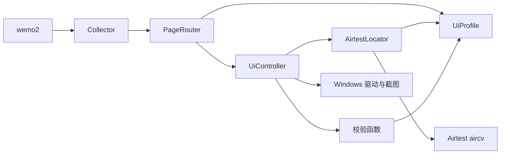

# 采集模块架构（已合并进 wemo2）

采集模块现位于 `src/wemo2/collectors`，由 `wemo2 collect` 运行。资源根目录与账号由 core/config.py 的 AppConfig 传入，采集模型只维护 UI 专属字段；MomentRecord 等本地元信息在 api/records.py 中，截图裁剪用的 MomentDetails 留在 collectors/models.py。

采集器直接完成本地归档合并，返回 CollectResult。`wemo2 save --memos` 只读取归档，不调用 UiController 或驱动；当前存储是 pseudo，Memos 0.31 实现延后。旧独立调试模块、Observation 交付、去重器和协调器已经删除，VS Code 统一调试根 main.py。


状态：Windows 已接入截图、发现页导航、朋友圈选中验证、锚点分段、昵称 OCR 及媒体另存为流程。
Windows 图片查看器及控件另存为已完成单张图片实机验证；视频保存、视觉识别完整度及 Android 适配仍需继续验证和完善。

## 当前采集与下载顺序

扫描阶段由 FeedCapture 拼接完整动态；MomentArchive 仅将同时确认头像和底部锚点的图像写作归档主截图，首尾半张仍保留于扫描证据。识别昵称时为头像顶部留出空间，避免按文字框裁掉头像。MediaCapture 在扫描阶段不再重复 OCR 和下载半张卡片。

MomentArchive 根据完整文案、昵称和发布日期生成 MediaDownload 计划，范围使用拼接流坐标，目录直接指向最终朋友圈的 media 子目录。扫描完成后 FeedCapture.download_media 从终点反向回看，每步验证静态区域重叠后更新流位置；无法验证就停止，避免将图片保存给错误的朋友圈。下载落盘后 register_download 立即登记 JSON，本目录内文件不再复制一份。

默认 save_media_shortcut 流程使用打开预览、等待加载、Ctrl+S、标准文件名控件输入、Enter、文件验证、返回列表。save_media 保留右键菜单流程，SaveDialogConfig.submit 可切换 enter/message。两套入口复用文件稳定性与超时机制。

来源为视频号的计划带 skip_reason，保留朋友圈截图而不点击下载；未知来源误打开视频号时，控制器通过顶部 OCR 标题和邻近 channel_close 模板关闭标签并验证，随后记录 video_channel，后续视口不再重复打开。该关闭目标属于 UiProfile；应用层只组装采集器，不感知目标或截图布局。

## 1. 精简后的边界

应用层负责组件选择、共用配置、日志及 collect/save 命令；本地去重在采集归档中完成。
界面采集包自行解释 `collector_options`，应用不读取窗口、主题、模板或截图字段。
唯一组件登记处 core/registry.py 绑定采集器与 `prepare_options`；校验配置不启动设备或创建输出文件。core/services.py 执行采集或保存，cli 负责终端交互；common 基础函数与 archives 归档规则不导入采集模型。

采集包已删除单实现的内部抽象、两套注册器、独立匹配器和未实现的 OCR/卡片解析接口。
新增实际使用的 FeedCapture、TextRecognizer、MediaCapture 及数据模型，不预先增加空接口。
保留 api/interfaces.py 的 BaseCollector 与平台 BaseDriver；未来确实出现第二种实现时再抽取其他接口。

| 部分 | 文件 | 职责 |
| --- | --- | --- |
| UiProfile | profiles.py | 一个 Pydantic 结构维护页面、路由及各主题模板 |
| AirtestLocator | locating.py | 直接调用 Airtest 匹配，补充范围、DPI 与唯一目标检查 |
| UiController | controller.py | 规范截图、定位、单次输入、等待、结果与证据 |
| PageRouter | routing.py | 查询路径，将目标、前置页面和预期交给控制器 |
| FeedCapture | feed.py | 有上限的滚动采集、重叠验证、拼接和锚点切分 |
| TextRecognizer | recognition.py | 调用 RapidOCR 识别昵称和另存为菜单 |
| MediaCapture | media.py | 可见卡片识别、媒体保存流程及文件关联 |
| 校验函数 | validation.py | 共用截图、目标、页面及区域变化校验 |
| WindowsDriver | windows/driver.py | Airtest 会话、物理坐标、焦点与输入 |
| WindowsScreenshotter | windows/screenshot.py | 截取客户区，按配置时区保存 PNG 和元数据 |
| WindowsScreenshotCollector | collector.py | 组装上述能力并释放会话 |



当前少量重试循环保持显式，不引入 Tenacity、状态机或插件框架。
通用图像算法交给已有 Airtest；微信页面特征、动作证据和停止语义由本项目维护。

## 2. 页面与主题数据

`build_profile()` 是内置微信数据的唯一维护处，返回独立 UiProfile：

- `pages`：页面名称 → PageSpec，包含 required 和 forbidden 标志。
- `routes`：动作名称 → RouteSpec，包含源页面、目标页面、点击目标及验证策略。
- `themes`：主题名称 → 语义目标名称 → TemplateSpec。

Pydantic 检查名称与键一致、保留名称、路由端点及目标验证标志。
启动时检查所选主题是否覆盖全部页面和路由目标。
新增页面、路由或主题修改数据即可，不在定位算法、控制器或路由中增加微信名称分支。

`home` 由灰色指南针及选中图标缺失判断。
`discover` 必须同时匹配选中指南针和发现菜单，并排除朋友圈已选中标志。
`moments_selected` 匹配绿色背景、白色图标和文字的朋友圈选中行；表示菜单已选中。
`moments` 尚无可靠页面标志，不参与自动检测，ensure() 不能宣称已到达。
未知或多个页面同时命中时返回 unknown，拒绝继续导航。

`discover` 动作验证发现页；`moments_entry` 动作点击朋友圈菜单，等待并验证
`moments_selected`。已处于目标状态时跳过点击。超时保留已执行标志与证据，不重复点击。
选中模板 `moments_menu_selected.png` 来自真实选中截图的局部裁剪，不包含窗口坐标。
模板匹配成功不代表朋友圈动态列表已经加载；`moments` 仍不能自动验证。
未验证页面只能作为路径终点，完整路径先校验再执行第一个点击。
目前只有深色模板；选择未配置的 light/auto 会报错，不假装已兼容。

## 3. Airtest 定位适配

使用 `airtest.aircv.template_matching.TemplateMatching.find_all_results()`。
项目不再自行计算匹配矩阵、置信度、候选抑制和反复屏蔽匹配结果。

适配器只做这些处理：

1. 按主题查模板，将截图裁到配置的搜索区域。
2. 按参考 DPI 适配三个邻近模板尺寸，并转换为 Airtest 的 BGR 输入。
   TemplateSpec 的 `rgb` 默认 false；选中行使用 true，通过 Airtest 校验颜色。
3. 拒绝平坦模板、多个匹配及不同尺寸下的独立目标。
4. 将 Airtest 矩形和置信度转换为 LocatedTarget。

Airtest 的多尺度最佳匹配接口不能枚举全部候选，不能单独证明目标唯一。
因此目前使用多目标模板匹配加有限 DPI 适配，不承诺任意尺寸或任意皮肤都能识别。
Airtest 图像与设备模块延迟加载，日志统一转入 Loguru，默认控制台输出，文件输出可选。

## 4. 标准动作协议

控制器的 capture()/locate() 输出截图或定位结果，点击/滑动输出 ActionResult。

- capture：窗口准备 → 截图 → 共用图片与焦点校验 → 保存证据。
- click：新截图 → 检查源页面 → 定位与校验 → 点击一次 → 等待重绘 → 观察预期。
- swipe：新截图 → 定位操作区域 → 校验 → 区域内拖动一次 → 观察预期。

截图/定位在输入之前允许有限重试；输入和验证失败后只观察，不能自动重发动作。
操作调用抛错时 attempted=True、executed=False，可能部分执行，不自动再次尝试。
调用正常返回后 executed=True；后续截图失败或验证超时不会抹掉这个事实。

| status | 含义 |
| --- | --- |
| executed | 动作正常返回，未配置验证预期 |
| verified | 动作正常返回，指定预期已通过 |
| pending | 动作正常返回，但目标页面尚无验证特征 |
| failed | 截图、定位、输入、验证或证据保存失败 |

每次输入保存 action_<UUID>.json，包括前后截图、目标、方向/距离、预期、校验结论和错误。
失败时同样保存证据，磁盘写入失败明确报错；路由通过 UiActionError.result 传播结构化失败。
调试可查看 collector.controller.results 和 router.last_result。

校验函数复用同一份尺寸、黑屏、时效与范围规则；输入前仍重新核对窗口和焦点。
区域变化预期只比较选定像素区域，不能据此判断真实动态翻页或已经到底。
Windows swipe 是鼠标拖动；FeedCapture 使用独立的 scroll 动作调用 Airtest 鼠标后端滚轮。

## 5. 配置与截图

```toml
collector = "windows_screenshot"
# 默认输出控制台，需要同时写文件时启用：
# log_file = "logs/wemo2.log"

[collector_options]
platform = "windows"
window_title = "微信"
maximize_window = true # 连接时最大化主窗口，等待尺寸稳定后截图；false 保留原大小。
screenshot_dir = "data/screenshot"
timezone = "Asia/Shanghai"
theme = "dark"

[collector_options.matcher]
threshold = 0.9

[collector_options.route]
target = "moments_entry"
timeout_seconds = 5

[collector_options.controller]
capture_attempts = 2
locate_attempts = 2
poll_interval = 0.2
verification_timeout = 5
max_frame_age = 5
```

原有 TOML 和 F5 入口保持可用，内部类型名称变更不需要迁移这些配置。
none 只截图；其他动作名称来自 profile。相对路径由采集器相对配置目录解析。
CLI 提供 collect/save 子命令，共用帮助、版本、配置路径和日志路径；save 额外支持 --memos。

窗口必须可见、完整处于屏幕内且无遮挡。Airtest 获取虚拟桌面后裁切客户区，
完整桌面只在内存中存在，PNG 与 JSON 保存到截图目录。
坐标使用物理像素，允许负屏幕原点；线程 DPI 感知和 Airtest dpifactor=1 防止重复缩放。
同进程独立窗口可以跟随；其他进程前台窗口拒绝跟随。释放设备资源不关闭微信。

时区默认 Asia/Shanghai；文件名与 captured_at 使用配置时区并保留 UTC 偏移，
timezone 保存 IANA 名称。ZoneInfo + tzdata 提供 Windows 时区数据，启动时拒绝无效名称。
时效比较使用带时区时间点，跨时区不影响五秒限制，旧元数据缺少时区名称仍能读取。

## 6. 数据解析与验证

当前采集器交付 CollectResult、本地朋友圈目录、截图证据和实际另存为文件；不再输出 Observation。

## 7. 锚点分段与媒体采集

`FeedCaptureConfig` 全部由采集包维护。`enabled=false` 保持单次截图/导航；
朋友圈调试 TOML 开启滚动、昵称和媒体保存，默认最多 20 帧。

1. 在配置的列表区域执行 `locate_all("moments_anchor")`，重复锚点按纵坐标排序。
2. 以按钮下沿及 DPI 留白切分。首尾未闭合部分标记 partial，不冒充完整动态。
3. 滚动由 UiController 发出一次 scroll，校验区域变化并保存前后截图和动作结果。
4. Airtest 匹配上一视口底部与新视口的内容；唯一重叠才可拼接，仅追加新露出的像素。
5. 重叠无法确认、首次无锚点、无进展或达到上限时停止，保留原图及清单。

`TextRecognizer` 通过 RapidOCR 获取行文本、范围和置信度。昵称采用动态顶部蓝色文本
与邻近头像布局，无法确认则保持未知。模型延迟加载，日志转发 Loguru。
昵称、预览内容和位置均不能生成微信稳定源身份。

`MediaCapture` 按可见锚点保存卡片和 JSON，以 OpenCV 连通区域发现深色页面媒体候选。
点击前重拍并比较候选区域，内容发生变化则拒绝使用旧位置。进入同进程独立查看器，
右键后 OCR 唯一定位另存为菜单，再进入标准 Windows 对话框。文件名使用 UUID，
输入框不唯一时停止。记录非空、稳定文件的类型、大小和 SHA-256，再返回原列表。
同一次采集中，仅相邻截图已确认重叠且流坐标相同的媒体可复用保存结果。

截图及输入统一经过控制器；文件对话框的控件操作只在 WindowsDriver 内，
复用 Airtest 已带的 pywinauto Win32 后端，不引入 UI Automation 后端。
`SaveDialogConfig` 由采集配置传入驱动，管理总等待预算、单次消息超时、就绪尝试次数和轮询间隔。
先重试控件就绪及 `WM_NULL` 响应探测，再用已有 pywin32 的 `SendMessageTimeout`
向保存按钮发送一次 `BM_CLICK`。消息超时仍可能已经执行，因此只继续观察对话框和文件，
不重发保存输入。等待期间每 5 秒记录状态；超时区分未关闭对话框和未稳定落盘。
保存成功后截图或返回失败，仍保留文件路径和 executed 事实，不重复下载输入。
图片检查可解码性；视频目前仅检查容器头，完整播放及最高质量原图尚需另行核验。
卡片的 `media_detection=none_detected` 表示未识别到候选，不表示动态肯定没有媒体。
2026-10-12 已验证从微信图片菜单打开标准保存框并通过上述消息流程保存一张 JPG；
该验证不覆盖自动菜单 OCR、多图片切换或视频特有的保存界面。
OCR 及卡片解析输出采集私有 MomentDetails；MomentArchive 通过人物与完整文案生成身份键并合并归档，不再经过独立去重器。截图重叠只是拼接证据，不直接作为朋友圈身份。

测试覆盖 Airtest 实际模板匹配、DPI、歧义、页面状态、单次输入、时效、进展、
配置边界、异常日志、证据保存和资源释放。纯自动测试不代表真实微信、多屏与皮肤均已联调。

## 8. 配置驱动的媒体步骤

已采用 MAA 参考文档中的小型步骤方案，保持现有 Python 组件与平台驱动。
三个 Pydantic 模型只描述数据：

- `MediaTargetSpec`：动态预览、相对区域或 OCR 文字，包含候选文字、阈值和 ROI。
- `MediaStepSpec`：动作、目标、前置状态、后置验证、等待时间和唯一后继。
- `MediaWorkflowSpec`：入口、菜单识别目标、步骤表和运行上限。

它们统一由 `UiProfile.media_targets/media_workflows` 维护，不增加任务继承或插件体系。
内置 `save_media` 定义打开查看器、等待加载、打开菜单、选择另存为、保存文件、返回列表六步。
启动时检查目标和后继存在、状态衔接、步骤可达性、输入循环及运行上限。
每个流程必须恰好保存一次、返回一次，未知流程在应用配置加载时拒绝。

`UiController.run_media_workflow` 根据动作类型调用既有 `_perform/platform_step`。
新帧解析目标后验证帧、窗口和范围；源预览再次核对内容，OCR 目标必须唯一且达到阈值。
输入只执行一次，后置条件失败只重新截图观察。文件保存前必须识别标准另存为窗口；
保存调用返回后执行文件验证回调，再确认已回到查看器。关闭后确认原窗口及媒体内容连续性。
`WindowsDriver.is_save_dialog()` 只读检查窗口类和标题；实际输入仍由 `save_dialog()` 承担。

文件验证由 `MediaCapture` 负责，哈希调用 `common.files.sha256_file` 流式计算真实文件 SHA-256，采集归档和保存读取共用该函数。
保存成功但后续截图或返回失败时，文件、哈希和 `last_saved` 仍可写入卡片清单。
动作证据的 `workflow` 记录流程名，`name` 记录步骤名，`validation` 记录实际后置检查。
所有失败分支统一停止并保留证据，暂不支持自动恢复或重发输入。

应用与存储接口不感知这些步骤。昵称和图像块布局仍保持原实现，未在本次扩展。
窗口内查看器及视频专用界面仍需新的资源与实机样本；此重构不代表已验证其兼容性。

## 9. 朋友圈资源归档

共用 `AppConfig` 维护 `resource_dir` 与 `account`，由注册表传给采集器。配置文件解析相对资源路径，
组装入口负责创建 `MomentArchive`，核心 wemo2 不解释目录布局或截图字段。
输出层级为资源根目录 → 备份账号 → 推断的发布日期（YYYY-MM-DD） → 去除 emoji 后的人物名 → 朋友圈身份键。

`TextRecognizer.post_details` 识别人名、文案、时间原文；`dates.approximate_day`
以截图时区推断到日。`api/records.py` 定义 Pydantic 数据契约与相对资源引用。
`FeedSegment.stream_start/stream_end` 关联已拼接动态与 `SavedPreview.stream_y`，
使跨屏媒体进入所属朋友圈，而不依赖可见卡片是否完整。
MediaCapture 也处理尚未出现结尾锚点的可见尾段，避免长动态的上排媒体滚出窗口后遗漏。

MomentArchive 在采集结束或失败时汇总：保存截图、校验并拷贝媒体、最后原子替换 post.json。
同账号的人物和完整文案用于本地归档去重；日期不参与身份键，媒体按实际字节哈希合并。
未知人名或不完整文案不参与身份合并；未知日期保留 unknown_date。
这是一条用户选择的本地留痕规则，未替代已归档朋友圈的身份键。
失败保留已下载文件和错误信息，媒体总数未知时不声明 media_complete=true。
目录协议详见 `doc/moment-resources.md`。

发现入口可恢复微信上次打开的朋友圈子页面。`RouteSpec.alternate_destinations`
在 UiProfile 声明允许的恢复页面，`Expectation.alternate_pages` 逐个验证其标志。
当实际页面已是导航终点时，PageRouter 立即返回，跳过后续菜单点击。
`ensure(page)` 仍要求精确页面，未配置标志的页面不能作为恢复成功条件。

加载步骤是只读 `wait_ready`，ActionResult 的 attempted/executed 均为 false；等待后通过查看器状态与 OCR 加载提示校验，超时停止。等待与总超时配置在 FeedCaptureConfig。标准保存对话框使用 Win32 控件 ID 填写及提交，不发送依赖焦点的 Enter，也不使用图片模板。

滚动进展、动画稳定与相邻视口匹配均使用 UiProfile.feed_static_width 定义的头像侧栏，避开播放中的视频。默认 wheel_steps=3，在列表左侧空隙发送一次滚轮。验证失败也保存最后原始帧，不把视频播放当作滚动或历史到底。FeedCapture 的进度回调在当前帧媒体处理后增量导出闭合片段，采集结束导出末段。

图片批次由 `media_navigation.py` 的 `ImageSaveStrategy` 契约及 `ArrowImageStrategy`、`ReopenImageStrategy` 两种实现维护，选择集中在 `image_save_strategy`。FeedCaptureConfig.use_image_arrows 默认 true。策略只编排同一可见卡片的候选，不跨朋友圈或自动寻找未定位图片。

控制器允许从已验证的查看器继续媒体流程，并在实际保存文件为图片时保留查看器。切换方向键的输入、后置图片内容校验与退出均记录 ActionResult；独立查看器先核对原会话窗口归属，再用 Airtest 对照目标缩略图校验放大图。不能把画面任意变化或视频播放当成下一张。只有 switch_image 失败触发重开兜底，先验证退出回到原列表，再重新定位剩余候选；保存异常、窗口归属变化或退出失败均停止，不自动重发方向键或保存。

ViewerSession 保存当前查看器证据和批次缓存起点。下载文件立即留下 SavedPreview 和卡片记录，整批成功返回列表后才标记 workflow_complete，避免失败批次被缓存误当作完成。视频保存后退出；左右键由 BaseDriver.switch_image 平台能力提供，WindowsDriver 使用 Airtest 的 keyevent。标准另存为对话框仍使用 Win32 控件，与方向键切换策略无关。

人名规范化调用 common.names.normalize_person，原文保存在 person_raw。OCR 的蓝色昵称片段合并后再清洗 emoji，正文不受影响。MomentArchive 通过 archives.paths 生成账号/日期/人物/朋友圈目录，保存命令共享同一目录规范。post.json 的最终写入复用 common.files.write_model_json，资源范围检查复用 common.paths。
