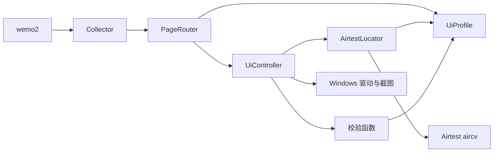

# wemo2_collector 架构

状态：Windows 使用 Airtest 完成截图、发现页导航、朋友圈菜单点击和选中状态验证。
尚未完成朋友圈动态列表验证、OCR、动态解析、朋友圈滚动采集及 Android 适配。

## 1. 精简后的边界

`wemo2` 负责组件选择、日志、重复策略、去重及持久化。
界面采集包自行解释 `collector_options`，应用不读取窗口、主题、模板或截图字段。
唯一组件登记处绑定采集器与 `prepare_options`；校验配置不启动设备或创建输出文件。

采集包从 37 个类精简为 24 个，包括数据模型与配置模型。
删除了单实现的内部抽象、两套注册器、独立匹配器和未实现的 OCR/卡片解析接口。
保留核心 BaseCollector 与平台 BaseDriver；未来确实出现第二种实现时再抽取其他接口。

| 部分 | 文件 | 职责 |
| --- | --- | --- |
| UiProfile | profiles.py | 一个 Pydantic 结构维护页面、路由及各主题模板 |
| AirtestLocator | locating.py | 直接调用 Airtest 匹配，补充范围、DPI 与唯一目标检查 |
| UiController | controller.py | 规范截图、定位、单次输入、等待、结果与证据 |
| PageRouter | routing.py | 查询路径，将目标、前置页面和预期交给控制器 |
| 校验函数 | validation.py | 共用截图、目标、页面及区域变化校验 |
| WindowsDriver | windows/driver.py | Airtest 会话、物理坐标、焦点与输入 |
| WindowsScreenshotter | windows/screenshot.py | 截取客户区，按配置时区保存 PNG 和元数据 |
| WindowsScreenshotCollector | collector.py | 组装上述能力并释放会话 |



当前少量重试循环保持显式，不引入 Tenacity、状态机或插件框架。
通用图像算法交给已有 Airtest；微信页面特征、动作证据和停止语义由本项目维护。

## 2. 页面与主题数据

`build_profile()` 是内置微信数据的唯一维护处，返回独立 UiProfile：

- `pages`：页面名称 → PageSpec，包含 required 和 forbidden 标志。
- `routes`：动作名称 → RouteSpec，包含源页面、目标页面、点击目标及验证策略。
- `themes`：主题名称 → 语义目标名称 → TemplateSpec。

Pydantic 检查名称与键一致、保留名称、路由端点及目标验证标志。
启动时检查所选主题是否覆盖全部页面和路由目标。
新增页面、路由或主题修改数据即可，不在定位算法、控制器或路由中增加微信名称分支。

`home` 由灰色指南针及选中图标缺失判断。
`discover` 必须同时匹配选中指南针和发现菜单，并排除朋友圈已选中标志。
`moments_selected` 匹配绿色背景、白色图标和文字的朋友圈选中行；表示菜单已选中。
`moments` 尚无可靠页面标志，不参与自动检测，ensure() 不能宣称已到达。
未知或多个页面同时命中时返回 unknown，拒绝继续导航。

`discover` 动作验证发现页；`moments_entry` 动作点击朋友圈菜单，等待并验证
`moments_selected`。已处于目标状态时跳过点击。超时保留已执行标志与证据，不重复点击。
选中模板 `moments_menu_selected.png` 来自真实选中截图的局部裁剪，不包含窗口坐标。
模板匹配成功不代表朋友圈动态列表已经加载；`moments` 仍不能自动验证。
未验证页面只能作为路径终点，完整路径先校验再执行第一个点击。
目前只有深色模板；选择未配置的 light/auto 会报错，不假装已兼容。

## 3. Airtest 定位适配

使用 `airtest.aircv.template_matching.TemplateMatching.find_all_results()`。
项目不再自行计算匹配矩阵、置信度、候选抑制和反复屏蔽匹配结果。

适配器只做这些处理：

1. 按主题查模板，将截图裁到配置的搜索区域。
2. 按参考 DPI 适配三个邻近模板尺寸，并转换为 Airtest 的 BGR 输入。
   TemplateSpec 的 `rgb` 默认 false；选中行使用 true，通过 Airtest 校验颜色。
3. 拒绝平坦模板、多个匹配及不同尺寸下的独立目标。
4. 将 Airtest 矩形和置信度转换为 LocatedTarget。

Airtest 的多尺度最佳匹配接口不能枚举全部候选，不能单独证明目标唯一。
因此目前使用多目标模板匹配加有限 DPI 适配，不承诺任意尺寸或任意皮肤都能识别。
Airtest 图像与设备模块延迟加载，日志统一转入 Loguru 文件 sink。

## 4. 标准动作协议

控制器的 capture()/locate() 输出截图或定位结果，点击/滑动输出 ActionResult。

- capture：窗口准备 → 截图 → 共用图片与焦点校验 → 保存证据。
- click：新截图 → 检查源页面 → 定位与校验 → 点击一次 → 等待重绘 → 观察预期。
- swipe：新截图 → 定位操作区域 → 校验 → 区域内拖动一次 → 观察预期。

截图/定位在输入之前允许有限重试；输入和验证失败后只观察，不能自动重发动作。
操作调用抛错时 attempted=True、executed=False，可能部分执行，不自动再次尝试。
调用正常返回后 executed=True；后续截图失败或验证超时不会抹掉这个事实。

| status | 含义 |
| --- | --- |
| executed | 动作正常返回，未配置验证预期 |
| verified | 动作正常返回，指定预期已通过 |
| pending | 动作正常返回，但目标页面尚无验证特征 |
| failed | 截图、定位、输入、验证或证据保存失败 |

每次输入保存 action_<UUID>.json，包括前后截图、目标、方向/距离、预期、校验结论和错误。
失败时同样保存证据，磁盘写入失败明确报错；路由通过 UiActionError.result 传播结构化失败。
调试可查看 collector.controller.results 和 router.last_result。

校验函数复用同一份尺寸、黑屏、时效与范围规则；输入前仍重新核对窗口和焦点。
区域变化预期只比较选定像素区域，不能据此判断真实动态翻页或已经到底。
Windows swipe 是鼠标拖动，目前没有朋友圈滚轮翻页路由。

## 5. 配置与截图

```toml
collector = "windows_screenshot"
log_file = "logs/wemo2.log"

[collector_options]
platform = "windows"
window_title = "微信"
screenshot_dir = "data/screenshot"
timezone = "Asia/Shanghai"
theme = "dark"

[collector_options.matcher]
threshold = 0.9

[collector_options.route]
target = "moments_entry"
timeout_seconds = 5

[collector_options.controller]
capture_attempts = 2
locate_attempts = 2
poll_interval = 0.2
verification_timeout = 5
max_frame_age = 5
```

原有 TOML 和 F5 入口保持可用，内部类型名称变更不需要迁移这些配置。
none 只截图；其他动作名称来自 profile。相对路径由采集器相对配置目录解析。
CLI 仍只有帮助、版本、配置路径和日志路径。

窗口必须可见、完整处于屏幕内且无遮挡。Airtest 获取虚拟桌面后裁切客户区，
完整桌面只在内存中存在，PNG 与 JSON 保存到截图目录。
坐标使用物理像素，允许负屏幕原点；线程 DPI 感知和 Airtest dpifactor=1 防止重复缩放。
同进程独立窗口可以跟随；其他进程前台窗口拒绝跟随。释放设备资源不关闭微信。

时区默认 Asia/Shanghai；文件名与 captured_at 使用配置时区并保留 UTC 偏移，
timezone 保存 IANA 名称。ZoneInfo + tzdata 提供 Windows 时区数据，启动时拒绝无效名称。
时效比较使用带时区时间点，跨时区不影响五秒限制，旧元数据缺少时区名称仍能读取。

## 6. 数据解析与验证

当前采集器输出空 Observation 列表和界面证据，不生成假朋友圈数据。
未来 OCR 和卡片解析按实际需求实现，届时继续输出核心 Observation 契约。
重复由去重器判断，UI 层不将截图重复当作动态重复。

测试覆盖 Airtest 实际模板匹配、DPI、歧义、页面状态、单次输入、时效、进展、
配置边界、异常日志、证据保存和资源释放。纯自动测试不代表真实微信、多屏与皮肤均已联调。
