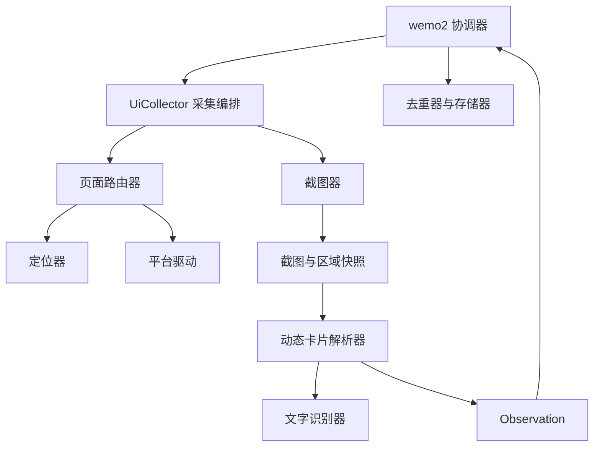

# wemo2_collector 界面采集架构

状态：已实现 Windows 只读窗口连接与截图，注册名为 `windows_screenshot`。
使用 Airtest 的 Windows 设备连接标题匹配且进程属于微信的唯一窗口；窗口枚举使用其底层
pywinauto Win32 后端，不依赖 UI Automation 控件树。截图前切到前台，Airtest 获取虚拟桌面，
再按客户区物理坐标裁切，保存 PNG 及 JSON 元数据。完整桌面只在内存中存在，不写入磁盘。
该方式要求窗口无遮挡；前台检查不能完全排除置顶悬浮窗、通知或同进程弹窗的遮挡。
已实现首版指南针入口模板定位和发现页面截图验证；尚未实现 EasyOCR 识别和朋友圈卡片解析。
`locating.py` 将用户参考截图的指南针图标作为模板，在左侧栏按 DPI 缩放匹配；
`routing.py` 最多点击一次，以绿色选中指南针和发现菜单的两个模板共同验证主窗口页面，
超时不宣称成功。用户后续参考图说明入口打开的是发现菜单，因此移除了独立窗口标题验证。
页面状态为 `Page.discover`，不能误判为 `Page.moments` 动态列表。
本轮先定义边界和数据流；Windows 首版实现随后按本设计接入，Android 只预留平台契约。
截图阶段可通过 `wemo2.screenshot.toml` 运行，默认目录为 `data/screenshot`。
采集器通过 `artifacts()` 交付保存路径，未识别动态时返回空 Observation 列表；协调器不生成伪造数据。
目录采用 `wemo2_collector`，便于标准 Python import；当前与 `wemo2` 一起打包，不是独立发行包。

## 1. 技术依据与适用边界

用户提供的[文章](https://www.cnblogs.com/zhaoweiwei/p/19731420/uiautomation)提出组合窗口控制、
截图、模板匹配、OCR 和输入模拟。它的完整示例针对聊天操作，不能直接当作朋友圈解析器，
也不能据此保证所有微信版本的页面结构或控件可访问性。

本设计采用以下能力组合：

- [Airtest](https://github.com/AirtestProject/Airtest)：Windows 窗口连接、前台激活、截图和点击；直接使用独立设备实例，不依赖全局当前设备或 AirtestIDE。未来 Android 可复用其设备能力，但页面布局与模板仍需单独适配。
- Pillow：将 Airtest 返回的 BGR 数组转成 RGB 图片并保存。Win32 API 仅用于客户区、DPI、焦点与可见性校验。
- [OpenCV 模板匹配](https://docs.opencv.org/4.x/d4/dc6/tutorial_py_template_matching.html)：定位预先准备的图标模板，保留匹配分数；模板大小、主题和缩放变化需要配置及验证。
- [EasyOCR](https://github.com/JaidedAI/EasyOCR)：读取图片中的文字及位置、置信度，首版计划用中文和英文、CPU 模式；Reader 初始化复用，不在每屏重复加载模型。

这是基于上述能力提出的架构，朋友圈导航与卡片布局需要后续用实际版本和截图验证。
不依赖文章中的固定坐标，也不复用发送消息的示例动作。首版只允许必要的导航、滚动和读取。

## 2. 组件边界



| 组件 | 输入与输出 | 职责 |
| --- | --- | --- |
| PlatformDriver | 配置 → Surface；点击/滚动请求 → 操作结果 | 连接窗口或设备，执行所有平台动作，验证坐标及当前目标 |
| Screenshotter | Surface → Screenshot | 获取并保存目标区域图片，记录窗口位置、尺寸、帧 ID 和时间 |
| Locator | Screenshot + 目标名 → LocatedTarget 或 None | 在当前帧内定位，不直接执行点击；可组合模板和 OCR |
| TextRecognizer | Screenshot → TextBlock 列表 | 输出原始文本、局部坐标和置信度，不猜测动态结构 |
| PageRouter | 页面目标 → 验证后的 Screenshot | 判断页面、寻找目标、调用驱动并验证跳转结果；有超时和重试上限 |
| MomentReader | 已确认的朋友圈 Screenshot → Observation 列表 | 卡片分割、字段关联、完整度判断及证据附加 |
| UiCollector | 平台及采集配置 → 逐条 Observation | 串联能力、维护会话、按需翻页、响应 stop，不负责最终去重或保存 |

`Locator` 定位导航目标；`MomentReader` 解析动态卡片，两者不能把 OCR 文本简单拼在一起代替结构识别。
策略停止由外部协调器根据去重器返回的 `is_duplicate` 决定，UI 层只响应停止，不重复实现去重规则。

## 3. 模块布局

已经落地的文件：

```text
src/wemo2_collector/
    __init__.py
    ARCHITECTURE.md
    models.py          # Platform、Page、Rect、Surface、Screenshot、LocatedTarget、TextBlock
    interfaces.py      # Driver、Screenshotter、Locator、Recognizer、Router、Reader 抽象接口
```

随后按实际实现增加以下模块，不提前放置返回假成功的占位实现：

```text
    collector.py       # UiCollector(BaseCollector)，平台与页面流程编排
    routing.py         # 页面状态判定与路由定义
    locating.py        # 模板/OCR 定位的组合策略
    recognition.py     # OCR 结果标准化与朋友圈卡片读取
    windows/           # Airtest 后端、WindowsDriver、WindowsScreenshotter
    android/           # 后续 AndroidDriver、AndroidScreenshotter
    profiles/          # 微信版本、主题、DPI 对应的页面标志及模板
```

共享目录不是平台适配器的全局注册表。可用的顶层 Collector 仍只在
`wemo2/registry.py` 注册，后续 UI Collector 从这里接收 `platform` 及界面配置。
依赖方向：wemo2 → 注册的 Collector → 路由/解析能力 → 平台驱动；接口层不导入具体驱动。
当前共享数据类型仍使用 `wemo2.models.Observation`，以后拆独立发行包时可再抽出公共契约包。

## 4. 平台参数与配置

新增 `platform`，表示数据源所在平台，不表示当前 Python 主机操作系统。
Windows 上的 Python 未来也可以通过设备驱动采集 Android，因此不能只根据 `sys.platform` 选择数据源。
标准名称为 `windows`、`android`；不使用拼写 `andriod`。

当前可以运行的示例：

```toml
collector = "pseudo"
platform = "windows"
duplicate_stop = "never"
```

`AppConfig.platform` → `run_config` → `build_coordinator(platform=...)` → 注册表参数映射 → Collector 构造函数。
现有 PseudoCollector、JsonCollector 接收平台参数，仅作为采集来源配置，不因此访问微信或 Android。
JSON 文件中原有来源信息不会被这个配置覆盖。

未来 UI Collector 还需要以下设置，尚未加入当前 AppConfig，不应复制到当前运行配置中：

| 设置 | 用途 |
| --- | --- |
| account_scope、device/instance ID | 隔离账号和设备来源，不能用昵称猜测身份 |
| window_title、process_id 或 Android device_id | 绑定目标实例，多个匹配时要求明确选择 |
| screenshot_dir、profile_path | 截图证据及版本对应的模板/页面描述 |
| route_timeout、retry_limit | 防止导航或识别无限等待 |
| max_pages、no_progress_limit | 限制页面总量和连续无进展次数 |
| confidence_threshold、match_threshold | OCR/模板可信度阈值，由实际样本调优 |
| dry_run | 只截图和识别，不执行鼠标或键盘动作 |

CLI 继续只有帮助、版本、配置路径、日志路径；平台及以上业务设置放在配置文件中。
未知平台在配置校验时拒绝。未来选择 Android 而未安装/实现对应驱动时，应报 `PLATFORM_UNSUPPORTED`，不能回退到 Windows。

## 5. 页面路由与动作验证

```text
unknown → 探测 → login / home / moments / detail / modal
home → 定位朋友圈入口 → 操作 → 重新截图 → 验证 moments
detail → 定位返回入口 → 操作 → 重新截图 → 验证 moments
modal → 仅处理明确允许的遮挡 → 重新探测
login / unknown → 明确报错并终止，不盲点固定坐标
```

- 路由表描述起始页、目标页、目标定位规则和后置页面标志；不把控件名写死在流程循环里。
- `ensure(Page.moments)` 返回已经验证的最新帧，不能只因为一次点击没有异常就宣称跳转成功。
- 每一步先定位目标，再确认帧仍对应当前窗口，操作后等待状态变化并重新识别。
- 弹窗、锁屏、登录页和窗口丢失是不同错误。截图失败或网络加载中不等于没有动态。
- 单次定位失败可以有限重试；超过限制保留诊断证据并终止本次任务。

## 6. 截图、坐标与识别契约

`Surface.bounds` 采用平台物理像素；`LocatedTarget.bounds` 和 `TextBlock.bounds` 采用当前截图局部像素。
简单窗口裁切时，屏幕位置 = 截图原点 + 局部位置。负屏幕坐标允许存在，不能按主屏幕尺寸随意截断。
Windows 驱动在连接前处理 DPI 感知；若识别侧缩放了图片，返回位置必须先转换回原始截图像素。

动作必须验证：目标 `frame_id`、窗口/设备标识、当前区域位置与尺寸、目标是否在截图内。
窗口移动、滚动、旋转或缩放后旧帧不能继续点击；重新截图定位。局部裁切还须保留父帧偏移。
Airtest 的窗口点击坐标相对窗口外框；驱动将客户区局部坐标转换后再调用 touch。
线程采用物理像素 DPI 感知，Airtest dpifactor 保持 1，避免重复缩放。
截图使用未绑定窗口的独立设备，按虚拟桌面原点裁切，兼容负屏幕坐标。
设备的 screen.close() 只释放资源；禁止使用 stop_app/kill 结束用户微信。

当前定位继续使用 OpenCV 的限定区域、多尺度模板匹配，保留分数与多目标拒绝。
Airtest 自动化后端与定位器分离，后续可通过 BaseLocator 接入 Airtest 图片匹配或 OCR。
更换后端不会自动兼容浅色、深色或新皮肤，仍需维护页面模板及主题策略。
不满足阈值、目标不唯一或识别结果不确定时返回失败，不用低分最高匹配强行点击。
OCR 只提供文字块；朋友圈卡片的作者、正文、时间、图片顺序需要 MomentReader 按布局关联。
首版只提取可见作者名称、正文和时间原文，媒体及评论缺失标记 partial/unknown。
只有可确认的源动态 ID 才标记稳定；OCR 文本、坐标或截图哈希不能充当稳定源动态 ID。

## 7. 采集会话与停止

```text
驱动连接并探测能力
router.ensure(moments)
循环处理当前帧：
    reader.read(frame)
    逐条 yield Observation
    外部协调器保存当前记录，判断重复及停止策略
    只有协调器请求下一条且本屏已输出完毕，才执行 router.advance()
    下一帧不存在且确认到底：结束
finally：释放会话与 OCR/截图资源
```

一期不做后台预取，避免协调器停止后鼠标还在操作。`stop()` 必须幂等并设置取消状态，
路由重试、等待和翻页在执行前检查；外部关闭生成器时，其 finally 必须释放连接。
停止时不关闭用户微信，不清理尚未交付的证据，不丢弃已经输出的 Observation。

同屏边界卡片和滚动重叠是正常情况，可向去重器再次交付。仅做采集会话内的进展判断，
不把“整屏截图重复”直接当成数据重复。页面 hash 不变只能说明无进展；达到限制但未确认到底，
应报 `NO_PROGRESS` 并标记覆盖不完整。评论或图片动画也可能让截图变化，必须结合内容区域判断。

## 8. 首版落地顺序与验收

1. Windows 连接及截图：只读探测窗口、区域、DPI，保存当前截图，明确绑定实例。
2. 简单识别器：使用固定截图测试模板定位和文字识别，输出位置、文本、分数；先不假定页面能自动导航。
3. 路由器：为已验证的微信版本准备页面 profile，接入导航与跳转后验证。
4. MomentReader：建立真实脱敏截图样本，提取可见卡片为 Observation，接入已有去重/存储流程。
5. 加入受控滚动、停止和无进展检测，再扩展 Android 驱动。

自动测试先使用假的驱动、静态截图和模拟 OCR 输出，覆盖未知页、低分/多目标、旧帧拒绝、
坐标偏移、超时、滚动无进展、部分卡片与停止后不再翻页。真实 Windows 联调验证多显示器、
DPI、窗口移动、主题与微信版本；不能用纯模拟测试宣称真实微信识别已完成。

截图可能包含私人内容，证据写入本地受控目录，日志只记录帧 ID、区域和状态，不打印正文。
截图保留期与最终媒体备份分别管理。OCR 模型下载及 Windows 专属依赖仅在用户选择 UI 实现时启用，
现有 CLI 的 help、version、JSON 和 pseudo 流程不应因此加载模型或连接窗口。

## 9. Airtest 依赖与日志

通过 uv 安装 Airtest；当前解析版本为 1.4.3，依赖 NumPy < 2 和
OpenCV contrib <= 4.6.0.66，因此移除独立的 opencv-python-headless，避免两个包覆盖同一个 cv2。
Airtest 及平台模块延迟加载；其标准 logging 日志转入 Loguru，使用应用已有文件 sink。
原有 windows_screenshot 注册名、TOML 配置和 VS Code 调试入口保持可用。
Android 仍未实现，选择该平台明确报错。
