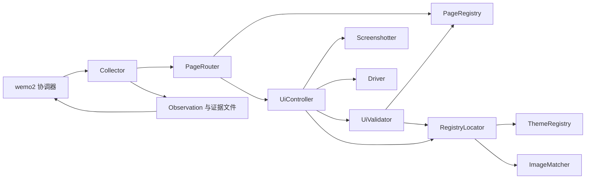

# wemo2_collector 架构

状态：Windows 使用 Airtest 实现截图、发现页导航、朋友圈菜单点击。
尚未完成朋友圈动态列表验证、OCR、动态解析、滚动采集或 Android 适配。

## 1. 应用与采集器边界

`wemo2` 管理组件选择、日志、重复停止策略、去重和持久化。
`wemo2_collector` 管理窗口/设备、截图、图片匹配、主题、页面、导航与动态解析。
应用只交付 `collector_options` 字典和配置目录，不读取其中的截图或页面字段。

唯一组装登记处 `wemo2/registry.py` 注册实现与 `prepare_options` 加载函数。
加载函数由实现所属包维护，负责校验专属配置及解析相对路径，返回构造参数。
它不能启动设备或创建输出文件；无效配置在创建存储器之前失败。
采集器输出 `Iterable[Observation]` 和通用证据文件路径，应用不解释截图内容。
`Platform` 是数据来源契约，位于 `wemo2.models`；界面模型不反向进入核心配置。

## 2. 组件职责

| 组件 | 文件 | 职责 |
| --- | --- | --- |
| PageRegistry | pages.py | 注册页面标志、排除标志和有向导航关系；查找路径 |
| ThemeRegistry | themes.py | 注册主题，把语义目标映射为模板、参考缩放和搜索区域 |
| TemplateMatcher / BaseImageMatcher | matching.py / interfaces.py | 只匹配图片，返回局部矩形和分数；不点击 |
| RegistryLocator / BaseLocator | locating.py / interfaces.py | 根据主题找到模板，委托匹配器处理 |
| UiController / BaseController | controller.py / interfaces.py | 规范截图、定位、单次输入、操作后等待、重试及动作证据 |
| UiValidator / BaseValidator | validation.py / interfaces.py | 独立校验截图、目标、页面预期和内容区域变化 |
| PageRouter / BasePageRouter | routing.py / interfaces.py | 查找注册路径、指定目标及预期、委托控制器执行 |
| WindowsDriver / BaseDriver | windows/driver.py | Airtest 会话、焦点、坐标和输入操作 |
| WindowsScreenshotter / BaseScreenshotter | windows/screenshot.py | 保存客户区 PNG 和截图元数据，拒绝黑屏/异常尺寸 |
| WindowsScreenshotCollector | collector.py | 组装上述组件，编排一次采集并释放会话 |
| WindowsCollectorConfig | config.py | 平台、窗口、截图目录、主题、匹配与路由的专属配置 |



匹配与点击分别由两个组件承担：匹配可在静态截图上离线测试，点击始终通过 Driver。
路由器不导入 Windows 实现，匹配器不包含微信目标名称分支。

## 3. 页面与主题的统一登记

页面、路由和皮肤资源只在 `profiles.py` 的 `build_profiles()` 中维护。
页面 ID 是注册字符串，不另建必须同步修改的枚举。

- `home`：灰色指南针存在，选中指南针不存在。
- `discover`：选中指南针和发现菜单同时存在。
- `moments`：尚无可靠特征，不参与页面检测，也不能通过 `ensure()` 宣称成功。
- `discover` 动作：home → discover，点击指南针并验证发现页。
- `moments_entry` 动作：discover → moments，点击朋友圈菜单并交付待验证截图。

未知页面或多个页面同时匹配时返回 `unknown`，不自动选择第一个候选。
路由在执行首个点击前校验完整路径，未验证页面只允许作为动作的终点。
验证超时不重复点击；已经到达可验证目标页时不重复导航。

新增页面只需登记 `PageSpec` 和 `RouteSpec`，无需修改通用路由器。
新增皮肤登记 `ThemeSpec`，为同一组语义目标提供该皮肤的 `TemplateSpec`。
注册器检查重复名称、路由端点、验证标志和主题目标覆盖。
当前只有真实深色模板；`light` 或 `auto` 尚未注册，选择时会报错，不能假装支持。
自动主题识别可以后续通过独立检测器接入，不属于页面路由职责。

## 4. 配置与扩展

```toml
collector = "windows_screenshot"
log_file = "logs/wemo2.log"

[collector_options]
platform = "windows"
window_title = "微信"
screenshot_dir = "data/screenshot"
timezone = "Asia/Shanghai"
theme = "dark"

[collector_options.matcher]
threshold = 0.9

[collector_options.route]
target = "moments_entry"
timeout_seconds = 5
```

`none` 只截图；其他动作名称来自页面注册表。
模板路径、参考 DPI 和搜索区域在主题数据中维护，不扩散为应用层配置字段。
专属相对路径由加载函数相对配置文件所在目录解析；代码传入专属字典时以传入目录为基准。
CLI 仍只有帮助、版本、配置路径、日志路径。旧顶层 UI 字段与 `[route]` 需要迁移。

注册新采集器时提供 `prepare_options(options, directory)`，返回构造函数所需参数。
新增专属字段只修改自己的 Pydantic 配置模型，不修改 `AppConfig` 或协调器。
将来切换匹配算法，实现 `BaseImageMatcher` 并在 Collector 内替换组装即可。

## 5. Airtest、截图与坐标

Windows 窗口枚举使用 Airtest 的底层 pywinauto Win32 能力，不再依赖 uiautomation。
连接限定精确标题、微信进程及可选进程 ID，多实例未指定目标时拒绝连接。
Airtest 抓取虚拟桌面后按客户区物理坐标裁切；完整桌面仅在内存中存在，不写入磁盘。
将 BGR 转成 RGB，保存 `data/screenshot` 下唯一命名的 PNG 和同名 JSON。

Surface 使用屏幕物理坐标，定位结果使用截图局部坐标；负屏幕坐标合法。
Driver 设置线程 DPI 感知，Airtest dpifactor 保持 1，避免重复缩放。
点击前检查帧 ID、五秒时效、客户区范围、当前窗口区域与前台焦点。
若点击打开同进程独立窗口，可跟随它截图；其他进程前台窗口拒绝跟随。

窗口必须可见且无遮挡，前台检查不能完全排除通知或置顶悬浮窗。
设备 screen.close() 只释放资源，停止采集不结束用户微信。
Airtest 延迟导入，其日志转交 Loguru 文件 sink，帮助和版本不会连接设备。
当前 Airtest 1.4.3 依赖 NumPy 1.x / OpenCV contrib 4.6，避免同时安装 headless 版本覆盖 cv2。

## 6. 数据解析与验收

当前导航返回空 Observation 列表，只交付截图证据，不能生成假朋友圈数据。
后续 BaseTextRecognizer 提供文字块，BaseMomentReader 按卡片结构生成 Observation。
动态重复由应用去重器判断，UI 层只响应停止，不以整屏截图重复代替数据重复。

测试使用静态模板及模拟平台组件，覆盖低分、歧义、旧帧、坐标偏移、未知页、超时、
页面/主题扩展、配置边界和资源释放。真实微信、多显示器与皮肤仍需实际联调。
截图和朋友圈调试入口保持可用；点击后页面未验证时日志明确标注待验证。

## 7. 控制器的标准动作协议

旧 `UiInteractor` 已由 `UiController` 替代，不保留职责重复的实现。
`PageRouter` 不再维护等待/重试循环，也不直接调用 Driver。
它只规划路径，并把目标、源页面前置条件和目标页面预期交给控制器。

- `capture()`：准备窗口 → 截图 → 校验窗口与实际图片 → 记录证据。
- `locate(name)`：自动截图 → 定位 → 校验帧归属、时效与目标范围。
- `click(name, expectation)`：新截图 → 校验源页面 → 定位 → 校验 → 点击一次 → 等待重绘 → 重新截图与验证。
- `swipe(name, direction, distance, expectation)`：定位操作区域 → 校验 → 区域内拖动一次 → 重新截图与验证。

点击和滑动返回 Pydantic `ActionResult`：

| status | 含义 |
| --- | --- |
| executed | 平台动作正常返回，未提供验证预期，不宣称页面成功 |
| verified | 平台动作正常返回，且指定预期通过验证 |
| pending | 平台动作正常返回，但目标页尚无验证特征 |
| failed | 截图、定位、输入、验证或证据保存失败 |

`attempted` 表示已经调用平台动作；若调用抛错，可能部分执行，不能自动重发。
`executed` 表示平台调用正常返回；后续截图失败或验证超时仍保留 True。
结果包含动作前后截图、定位位置、滑动方向/距离、预期、校验结果、错误及证据路径。
每次输入动作保存 `action_<UUID>.json` 到截图目录，失败时同样保存；磁盘写入失败会明确报错。
证据文件只记录本次动作的截图路径，不复制已有图片。

页面路由收到 failed 后通过 `UiActionError.result` 保留结构化失败并终止导航。
未验证的朋友圈菜单动作返回 pending；调用方不能据此假设已经进入动态列表。
调试时可查看 `collector.controller.results` 和 `router.last_result`。

`Expectation(kind="page", page="discover")` 使用注册页面标志。
`Expectation(kind="change", region=Rect(...))` 比较指定内容区域的变化比例，
不将窗口切换、通知区域变化或整幅画面重复当作已经到底；窗口/区域变化时拒绝比较。
应为滑动提供真实内容区域，默认整图变化只能证明像素发生变化，不能证明动态翻页成功。
Windows 的 Airtest swipe 是鼠标拖动；目前没有实现朋友圈滚轮翻页、到底判断或滑动路由。

```toml
[collector_options.controller]
capture_attempts = 2
locate_attempts = 2
poll_interval = 0.2
verification_timeout = 5
max_frame_age = 5
```

截图和定位仅在输入之前有限重试；验证时只重新观察，不再次点击或拖动。
页面路由的 timeout_seconds 可覆盖单次动作验证等待；settle_seconds 来自路由注册数据。
配置仍属于采集器，核心 wemo2 不读取这些字段。

## 8. 截图时区

时区配置属于采集器：`[collector_options] timezone = "Asia/Shanghai"`，默认上海时间。
使用标准库 ZoneInfo，tzdata 为 Windows 提供 IANA 数据，启动时校验名称。
截图文件名按该时区格式化并带 UTC 偏移；captured_at 保留偏移，timezone 保留 IANA 名称。
动作证据中的嵌套截图沿用同一时间。时效校验仍比较带时区的时间点，跨时区不影响五秒限制。
旧元数据缺少 timezone 字段时保持兼容，不推测或修改其时间含义。
